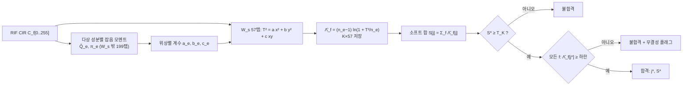

# RIF Λ̂ 판정기 F/W 구현 가이드

고정 칩(프래그먼트마다 RIF CIR 256탭만 얻는 경우)에서 **CIR 추정 Λ̂ 패킷 판정**을 F/W로 구현하기 위한 수식, 설정값, 수치 구현 조건, 확인 절차를 정리합니다.

- **입력:** 프래그먼트마다 RIF CIR `C[k] = x[k] + j·y[k]`, k = 0..255 (LLS 2열 덤프와 같은 정보). 원시 샘플 모멘트(5열 덤프의 Q·Π)는 쓰지 않습니다.
- **검증 상태:** LLS 단계 B 완료(2026-11-16). 오수락 10⁻⁶(FiRa medium)과 감도를 LLS 2열 덤프로 확인했습니다(`DECISIONS.md` "결정 1: LLS 검증", 결과 페이지 `docs/lls.html`).
- **참조 구현:** MATLAB `rif_cir_analyze(..., 'Chip', 'fixed')` → `rif_packet(R)`(기본값: 소프트 결합, 10⁻⁶, 여유 1.5, 하한 1, 이동 후보 0). 이 문서의 식과 상수는 그 코드와 같습니다(부록 A). 3장의 실수 2차형식은 참조 코드의 복소 식과 수치로 같음을 확인했습니다(차이 4e-15).

용어: 다상 성분 e = k mod 8, 신호 창 W_s, 잡음 탭(신호 창 밖), 소프트 합 S, 패킷 = 한 수신기의 거리 측정 1회에 쓰는 RIF 프래그먼트 K개.

---

## 0. 한 장 요약

```
프래그먼트 f마다  (C[k] = x[k] + j·y[k], k = 0..255)
  1) 잡음 모멘트: 다상 성분 e = 0..7마다 잡음 탭 N_e = {k ∉ W_s, k mod 8 = e} (n_e = 25, e = 7만 24)
       Q̂_e = (1/n_e) Σ (x² + y²)
       π_e = u_e + j·v_e,   u_e = Σ (x² − y²) / Σ (x² + y²),   v_e = Σ 2xy / Σ (x² + y²)
       |π_e| > 0.98 이면 π_e ← π_e · 0.98/|π_e|
  2) 위상별 계수:  g_e = 2 / (Q̂_e (1 − |π_e|²)),  a_e = g_e (1 − u_e),  b_e = g_e (1 + u_e),  c_e = −2 g_e v_e
  3) 신호 창 탭 k ∈ W_s = [119, 175] (57개), e = k mod 8:
       T²[k]  = a_e x² + b_e y² + c_e x y
       Λ̂_f[k] = (n_e − 1) · ln(1 + T²[k] / n_e)          ← H0에서 정확히 χ²₂

패킷(프래그먼트 K개)마다
  4) S[j] = Σ_{f=1..K} Λ̂_f[j]  (j ∈ W_s),   S* = max_j S[j],   j* = argmax (같으면 앞 탭)
  5) 수락:  S* ≥ T_K   그리고   모든 f에서 Λ̂_f[j*] ≥ 1
       T_K (W = 57, 이동 후보 1개, 올림) = 36.53 (K=1) / 42.75 (K=2) / 52.82 (K=4) / 69.61 (K=8)
  6) 출력: 수락 여부, 피크 탭 j*, S*, 프래그먼트별 Λ̂_f[j*] (무결성 플래그용)
```



---

## 1. 왜 이 판정기인가

| 항목 | 기존 Z 판정기 (피크 / 최대 위상 바닥, 두 단계 문턱) | CIR 추정 Λ̂ 패킷 판정 |
|---|---|---|
| H0 분포 | 채널·CFO·길이에 따라 바뀜 | 탭마다 정확히 χ²₂ (잡음 세기·모양과 무관) |
| 패킷 보장 | 없음. 같은 채널을 겪는 8개의 오검출이 패킷 안에 몰림(B-MD: 3개 이상 통과가 독립 가정의 5배) | 프래그먼트가 H0에서 독립(B-0 쌍 상관 +0.006)이라 패킷 문턱을 닫힌 식으로 정함 |
| 잔여 CFO 0 | 오검출 증가(B-H0-3: 256심볼 −82 dBm 0.94% → 5.88%) | 영향 없음. κ = 1에서는 보수적 |
| 감도 (32심볼, AWGN) | 프래그먼트 L90 −111.90 dBm | 패킷(K = 8) L90 −116.76 dBm (4.9 dB 좋음) |

Λ̂는 같은 다상 성분의 잡음 탭으로 그 프래그먼트의 잡음 세기(Q̂)와 모양(Π̂)을 재고, 신호 창의 각 탭을 그 잡음으로 백색화한 값입니다. 백색화한 값의 분포가 잡음 조건과 무관하게 고정되므로 문턱을 미리 계산한 상수로 둘 수 있습니다.

---

## 2. 입력과 설정값

| 이름 | 값 | 뜻 | 근거·검증 |
|---|---|---|---|
| CIR | `C[k]`, k = 0..255, 복소 정수 | 프래그먼트마다 하나 | LLS 덤프 값은 정수. 반올림 잡음의 몫 1.6e-5 (B-0) |
| 주기 P | 8 | HPRF 펄스 간격(다상 성분 수) | BPRF는 16이지만 검증 안 됨 |
| 신호 창 W_s | [119, 175], W = 57 | 피크(첫 경로) 후보 탭 | LLS 피크 탭 125 (설계 기본 127) |
| 잡음 탭 N_e | W_s 밖 전부 (199탭) | 위상 e의 잡음 표본 | n_e = 25 (e = 0..6), 24 (e = 7) |
| RhoMax | 0.98 | 비원형 계수 \|π\| 상한 | B-H0-3 (κ = 1에서 보수적) |
| PfaTarget | 10⁻⁶ | 패킷 오수락 목표 | 결정 1·2 |
| Margin | 1.5 | 문턱 여유 (목표/1.5로 설계) | 단계 B 꼬리 비율 ≈ 1 |
| K | 1 / 2 / 4 / 8 | 패킷당 RIF 프래그먼트 수 (NumRIF = 4 → 8) | B-H1 (8개), B-1R (1·2·4개) |
| 이동 후보 d | LLS: {0} | 패킷 안 피크 이동 탐색 | silicon 미정 (4.2절, 결정 5) |
| 하한 F_floor | 1 (임시) | 선택 경로에서 프래그먼트별 최소 Λ̂ | B-F·B-S. 결정 6 안 3으로 바꿀 예정 (4.5절) |

**신호 창과 잡음 탭을 정할 때**

- W_s는 기대 피크 위치(타이밍 불확실성 포함)를 모두 덮어야 합니다. 넓히면 문턱이 오릅니다(K = 8: W = 114이면 71.32, 약 0.25 dB 손해).
- 잡음 탭에는 신호(멀티패스 꼬리 포함)가 없어야 합니다. 신호가 섞이면 Q̂가 커져 감도가 떨어지고 Π̂가 틀어집니다.
- 잡음 탭은 W_s 밖을 **모두** 씁니다. 표본이 줄면 추정 잡음 때문에 문턱 상승이 커집니다(n = 25: 알려진 잡음 대비 약 2.4 dB, n = 10: 약 7.0 dB).
- W_s를 바꾸면 n_e도 다시 셉니다(설정마다 정해지는 상수). 아래 식은 모두 위상별 n_e를 씁니다.

---

## 3. 프래그먼트 처리

### 3.1 다상 성분별 잡음 모멘트

HPRF CIR에서 탭 k = 127 + 8m + e의 H0 값(열잡음과 틀린 키 신호의 자기잡음)은 위상 e의 펄스 모양에 서로 독립인 랜덤 합을 곱한 것입니다. 그래서 같은 위상의 탭은 위치와 무관하게 같은 분포를 따르고 서로 독립입니다(주기정상 잡음). 위상마다 세기가 다르므로(위상 간 바닥비 D) 모멘트는 **위상별로** 잽니다.

```
Q̂_e = (1/n_e) Σ_{k∈N_e} |C[k]|²          (잡음 세기)
Π̂_e = (1/n_e) Σ_{k∈N_e} C[k]²             (잡음 모양, 의사 분산)
π_e = Π̂_e / Q̂_e,   |π_e| ≤ 1               (비원형 계수, κ와 같은 성질)
```

실수 연산으로는 `C² = (x² − y²) + j·2xy`이므로 세 합 `Σ(x² + y²)`, `Σ(x² − y²)`, `Σ 2xy`만 누적하면 됩니다. π_e는 비율이라 1/n_e가 지워집니다.

### 3.2 비원형 보정과 상한

- 잔여 CFO가 작으면 틀린 키 신호의 자기잡음이 반송파 위상으로 돌지 않아 잡음이 복소평면의 한 방향으로 몰립니다(|π| → 1, B-H0-3에서 잔여 CFO 0이면 길이와 무관하게 κ = 1). Π̂를 빼고 원형 잡음으로 가정하면 이 조건에서 오검출이 늘어납니다.
- |π_e| > 0.98이면 크기만 0.98로 줄입니다(방향 유지): `π_e ← π_e · 0.98/|π_e|`. κ = 1에서 Λ̂가 χ²₂보다 작아지므로 보수적입니다(LLS −40 dBm 탭 꼬리 비율 0.20~0.77, κ = 1 합성 잡음 0.14~0.28).

### 3.3 탭 통계량 T² (2×2 백색화)

복소 식(참조 코드 `lambda_stat`):

```
T²[k] = 2 (|C[k]|² − Re(π_e* · C[k]²)) / (Q̂_e (1 − |π_e|²))
```

실수 2차형식(구현용, 같은 값):

```
g_e = 2 / (Q̂_e (1 − u_e² − v_e²))
a_e = g_e (1 − u_e),   b_e = g_e (1 + u_e),   c_e = −2 g_e v_e
T²[k] = a_e x[k]² + b_e y[k]² + c_e x[k] y[k]
```

- 탭 (x, y)를 잡음 공분산 추정값으로 백색화한 마할라노비스 거리입니다. |π| < 1이면 양의 정부호라 T² ≥ 0입니다.
- 위상별 계수 3개를 프래그먼트마다 한 번 계산하면, 탭마다 곱셈 5번과 덧셈 2번입니다. 나눗셈은 위상당 1번입니다.
- H0에서 T²는 Hotelling 분포를 따릅니다: `P(T² ≥ t) = (1 + t/n)^(−(n−1)/2)` (n → ∞이면 e^(−t/2)). 잡음을 n개 표본으로 추정했기 때문에 χ²₂보다 꼬리가 두껍습니다.

### 3.4 χ²₂ 환산 Λ̂

```
Λ̂[k] = (n_e − 1) · ln(1 + T²[k] / n_e)          H0: P(Λ̂ ≥ λ) = e^(−λ/2)  (정확히 χ²₂)
```

- 이 변환은 Hotelling 꼬리를 정확히 χ²₂로 바꿉니다. 그래서 K개의 합이 H0에서 χ²_{2K}를 따르고, 패킷 문턱을 닫힌 식(4.3절)으로 정할 수 있습니다. 변환하지 않은 T²를 더하면 꼬리가 두꺼워 같은 문턱에서 오수락이 목표를 넘습니다.
- Λ̂는 잡음 통계까지 추정하는 문제의 일반화 우도비 2·ln GLR = (n+1)·ln(1 + T²/n)의 (n−1)/(n+1)배입니다(`docs/glr.html`).
- 신호가 강하면 로그 때문에 값이 눌립니다(예: T² = 1000이면 Λ̂ ≈ 89). 판정은 문턱 근처만 중요하므로 문제없지만, 신호 크기 추정에 Λ̂를 그대로 쓰면 안 됩니다(4.5절).
- **K = 1이면 로그가 필요 없습니다.** `Λ̂ ≥ T` ⇔ `T² ≥ n_e (e^(T/(n_e−1)) − 1)`이므로 위상별 T² 문턱(T = 36.53에서 n_e = 25: 89.54, n_e = 24: 93.48)과 비교하면 됩니다.

### 3.5 F/W에 유리한 성질

- **스케일 무관:** C 전체에 상수를 곱해도 T²와 Λ̂는 그대로입니다. 프래그먼트마다 AGC 이득이 달라도(LLS AGC 표준편차 2.8 dB) 정규화가 필요 없습니다.
- **프래그먼트마다 독립 추정:** Q̂·Π̂는 프래그먼트마다 새로 잽니다. 패킷의 여러 프래그먼트에서 모으면 반송파 위상이 달라 유효 표본이 줄고 감도가 0.4~1.4 dB 나빠집니다(결정 9).
- **로그와 T²는 신호 창 57탭만:** 잡음 탭 199개는 모멘트 누적에만 씁니다.

---

## 4. 패킷 판정

### 4.1 패킷 구성

- 한 수신기의 한 거리 측정에 쓰는 RIF 프래그먼트 K개(시간 순 f = 1..K)가 한 패킷입니다. NumRIF = 4면 K = 8입니다.
- STS가 심볼마다 바뀌어 H0에서 프래그먼트는 서로 독립입니다(B-0: 쌍 상관 +0.006, 기준 ±0.0125).
- 패킷의 프래그먼트가 K개보다 적으면(누락) 그 패킷은 판정하지 않습니다(참조 코드는 버림). 남은 개수로 판정하려면 그 개수의 문턱을 써야 합니다.

### 4.2 소프트 합과 이동 후보

```
S_d[j] = Σ_{f=1..K} Λ̂_f[ j + round(d · (f − 1)) ]       (경로의 모든 탭이 W_s 안인 j만)
S* = max_{d, j} S_d[j]
```

- 경로 하나가 프래그먼트마다 같은(또는 이동한) 탭을 더합니다. H0에서 S_d[j]는 χ²_{2K}입니다.
- **LLS (검증 조건):** 이동 후보 d = 0 하나. LLS는 RIF 시작점을 설정 오프셋으로 옮겨 피크가 1탭 폭 톱니 안에 머뭅니다(B-0). 이 소수 탭 어긋남의 손해(L90 약 0.5 dB, L99 약 1 dB)는 단계 B 감도에 이미 들어 있습니다.
- **silicon (미정, 결정 5):** 오프셋을 어떻게 추정하고 쓸지에 따라 후보 수가 정해집니다.

| silicon 방식 | 패킷 안 피크 이동 | 이동 후보 |
|---|---|---|
| 시작점을 옮기지 않음 | 오프셋 × RIF 간격만큼 계속 밀림 (1 ms 간격이면 1 ppm당 약 1탭) | 후보 간격 1/(K−1), 범위는 최대 오프셋 (±0.5 ppm, K = 8이면 9개) |
| 추정 오프셋으로 시작점을 옮김 | 1탭 톱니 + 추정 오차만큼 밀림 | 오차 ≤ 약 0.07 ppm이면 1개, 넘으면 오차 범위만큼 |
| 정답에 가까운 오프셋으로 옮김 (LLS와 같음) | 1탭 톱니 | 1개 |

### 4.3 문턱

```
W · N_d · P(χ²_{2K} > T) = PfaTarget / Margin
P(χ²_{2K} > T) = e^(−T/2) · Σ_{i=0..K−1} (T/2)^i / i!
K = 1:  T = 2 ln(W / PfaTarget) + 2 ln(Margin)
```

탭 57개 × 후보 N_d개의 경로에 대한 합집합 상한입니다. F/W는 설정별 상수로 둡니다(W = 57, 10⁻⁶, 여유 1.5).

| K \ N_d | 1 | 3 | 7 | 9 |
|---|---|---|---|---|
| 1 | 36.53 | (해당 없음) | | |
| 2 | 42.75 | 45.05 | 46.81 | 47.34 |
| 4 | 52.82 | 55.28 | 57.17 | 57.73 |
| 8 | **69.61** | 72.33 | 74.41 | 75.02 |

- 상수는 **올림**으로 저장합니다(내림은 오수락을 늘림. K = 8에서 0.25 내리면 오수락 1.04배). 표는 소수 둘째 자리 올림 값이라, 다른 문서의 반올림 표기(K = 2: 42.74)와 0.01 다를 수 있습니다.
- W, N_d, 목표를 바꾸면 위 식으로 다시 계산합니다(참조 코드 `soft_threshold`, 이분법).

### 4.4 하한 검사 (현재 구현)

```
수락 조건에 추가:  모든 f에서 Λ̂_f[ j* + round(d* (f − 1)) ] ≥ F_floor  (F_floor = 1)
```

- "프래그먼트 하나라도 비어 있으면 폐기"의 첫 단계입니다. H0에서는 조건을 하나 더 거는 것이라 오수락을 늘리지 않습니다.
- 바꿔치기(빈 프래그먼트)의 Λ̂는 그 탭에서 χ²₂이므로 그 패킷을 버릴 확률은 1 − e^(−F/2) = 39.3%입니다(LLS B-S 38%).
- 비용: 패킷 L90 0.18~0.34 dB (B-F).

### 4.5 일관성 검사 안 3 (결정 6, 잠정, 도구 미구현)

목표: 맞는 키 패킷이 검사 때문에 버려지는 비율을 **모든 세기에서 0.1%**로 두고, 강한 신호에서는 바꿔치기를 거의 모두 잡습니다(+6.5 dB에서 약 99%).

Λ̂로 구현할 때는 신호 크기 추정과 분위수를 **Λ̂(또는 T²) 영역에서** 만들어야 합니다. 설계 페이지의 비중심 χ²₂ 분위수는 잡음을 아는 Λ 기준이라, 강한 신호에서 로그로 눌리는 Λ̂에 그대로 쓰면 틀립니다. 아래는 그 변환 제안입니다(미검증).

```
H1에서 T²의 분포 (같은 다상 성분의 잡음 표본 n개, 신호 크기 λ):
    (n − 1)/(2n) · T² ~ 비중심 F(2, n − 1; λ),     E[T²] = n (2 + λ) / (n − 3)
선택 경로에서 프래그먼트별 T²를 되돌림:  T²_f = n (e^(Λ̂_f/(n−1)) − 1)
신호 크기 추정:   λ̂ = max(0, (n − 3)/n · mean_f T²_f − 2)
하한 (LUT):      F(λ̂) = (n − 1) · ln(1 + 2 q / (n − 1)),   q = 비중심 F(2, n−1; λ̂)의 p 분위수,   p = 1 − 0.999^(1/K)
```

T²의 H1 분포가 비중심 F임은 몬테카를로로 확인했습니다(n = 25, λ = 0~100에서 분위수 10⁻³~0.9가 1% 안, 평균식 일치). 예시 LUT(n = 25):

| λ (프래그먼트당) | 0 | 10 | 20 | 40 | 80 | 160 |
|---|---|---|---|---|---|---|
| F (Λ̂ 영역), K = 8 | 0.00 | 0.04 | 0.98 | 5.76 | 15.22 | 28.09 |
| 참고: Λ 영역(잡음 앎), K = 8 | 0.00 | 0.04 | 1.07 | 7.73 | 28.66 | 81.61 |
| F (Λ̂ 영역), K = 4 | 0.00 | 0.07 | 1.31 | 6.42 | 16.06 | 28.99 |
| F (Λ̂ 영역), K = 2 | 0.00 | 0.13 | 1.70 | 7.15 | 16.96 | 29.95 |

- K = 8 소프트 합의 L90은 프래그먼트당 λ ≈ 9.6입니다. 감도 부근에서는 하한이 거의 0이라 정상 패킷을 버리지 않습니다(그 영역의 빈 프래그먼트는 오수락 10⁻⁶을 깨지 못함, 결정 6).
- 구현 전에 도구에 넣고 LLS로 정상 폐기율 0.1%와 바꿔치기 탐지를 다시 재야 합니다(B-F·B-S를 같은 코드로, 결정 6 "아직 하지 않은 것").

### 4.6 걸렸을 때의 처리 (결정 7)

| 용도 (세션 설정) | 처리 | 보고 |
|---|---|---|
| 보안 판단: 출입, 결제, 거리 기반 인증 | 그 측정 폐기 | STS 실패 상태 + 무결성 플래그 |
| 일반 용도: 측위, 추적, 보정 | 걸린 프래그먼트 m개를 빼고 K − m개로 다시 판정 | 측정값 + 무결성 플래그 |

뺄 때의 문턱: 어느 m개를 뺄지 값을 보고 고르므로 선택 수 C(K, m)을 합집합 상한에 곱합니다.

```
W · N_d · C(K, m) · P(χ²_{2(K−m)} > T_{K,m}) = PfaTarget / Margin
```

| (N_d = 1) | K = 2, m = 1 | K = 4, m = 1 | K = 4, m = 2 | K = 8, m = 1 | K = 8, m = 2 |
|---|---|---|---|---|---|
| T_{K,m} | 37.92 | 51.03 | 46.49 | 70.67 | 69.39 |

- 빼는 근거는 검사에 걸린 사실뿐입니다. 합을 최대로 만드는 선택 등 다른 기준으로 고르지 않습니다.
- 미정: 최대 m(제안: K = 8이면 1~2, K = 2·4면 1), 세션 설정 이름과 기본값(제안: 보안 판단 = 폐기), 플래그 형식. RIF 1개 구성에는 이 검사가 없습니다.

### 4.7 출력

| 출력 | 뜻 |
|---|---|
| 수락 여부 | S* ≥ T 그리고 하한(또는 일관성) 검사 통과 |
| 피크 탭 | 119 + j* (LLS 피크 125). 소프트 합의 argmax이며 첫 경로가 아닐 수 있음 |
| S*, d* | 소프트 합과 선택한 이동 후보 (진단, 신호 크기 추정) |
| Λ̂_f[j*] | 프래그먼트별 값 (무결성 플래그에 어느 프래그먼트인지 표시) |

- **ToA:** 피크 탭은 \|C\|²나 Λ̂의 최대 위치입니다. 멀티패스(주거 LOS)에서 첫 경로 125 ± 2 안에 들어오는 비율은 0.42~0.46입니다(B-H1-3). ToA에는 별도의 첫 경로 탐색이 필요하고, 탭마다 χ²₂인 Λ̂는 그 문턱 설계의 근거로 쓸 수 있습니다.

---

## 5. 수치 구현

### 5.1 연산 형식

- **float32 권장.** float64와의 차이는 Λ̂ 최대 1.5e-6입니다(합성 CIR로 확인). 비원형 보정 분자는 |π| ≤ 0.98에서 최대 약 50배 상쇄(6비트)라 float32 가수 24비트로 충분합니다.
- **고정소수점(FPU 없음):** 모멘트 합은 입력 비트의 2배 + 5비트(199탭)가 필요합니다. 스케일 무관이므로 프래그먼트마다 블록 지수(최대 Q̂_e 기준 시프트)를 써도 됩니다. 계수 a·b·c와 T²는 블록 부동소수점, ln은 표(5.3절)로 둡니다. 비트폭은 미정입니다(설계 문서 10장).

### 5.2 정밀도 예산

프래그먼트마다 Λ̂에 같은 방향의 오차 δ가 있으면 패킷 오수락이 늘어납니다(문턱 근처, 여유 1.5 중 사용분):

| 프래그먼트당 Λ̂ 오차 δ | 0.01 | 0.05 | 0.1 | 0.25 |
|---|---|---|---|---|
| 오수락 배수, K = 8 | 1.03 | 1.18 | 1.38 | 2.23 |
| 오수락 배수, K = 4 | 1.02 | 1.09 | 1.20 | 1.56 |
| 오수락 배수, K = 1 | 1.005 | 1.03 | 1.05 | 1.13 |

**목표: 같은 방향 오차 |δ| ≤ 0.01** (여유 1.5의 5% 이하 사용).

### 5.3 ln 구현

| 방법 | Λ̂ 최대 오차 (n − 1 = 24배) |
|---|---|
| `log1pf` (float32) | 1e-6 이하 |
| log₂ 지수 분리 + 가수 표 32칸 + 선형 보간 | 0.0028 (목표 안) |
| 같은 방식 16칸 | 0.011 (경계) |
| 같은 방식 64칸 | 0.0007 |

- 작은 T²에서 `logf(1 + x)`는 상대 오차가 커지지만 Λ̂ 절대 오차는 작아 판정에는 영향이 없습니다. `log1pf`가 있으면 그것을 씁니다.

### 5.4 연산량과 메모리 (프래그먼트 하나)

| 단계 | 연산 |
|---|---|
| 모멘트 | 잡음 탭 199개 × (제곱 2, 곱 1, 덧셈 3) |
| 위상 계수 | 8위상 × (나눗셈 2~3, 곱 약 8, 비교 1, 필요 시 제곱근 1) |
| Λ̂ | 신호 창 57탭 × (곱 5, 덧셈 2, 상수 곱 2, ln 1) |
| 패킷 (N_d = 1) | 57 × K 덧셈, 최댓값 탐색 57, 하한 비교 K |

- 저장: Λ̂_f[57] × K (K = 8, float32이면 1,824바이트). 하한·일관성 검사와 빼고 다시 판정(4.6절)에 프래그먼트별 값이 필요하므로 합만 누적하지 말고 K×57을 남깁니다.
- 시점: 프래그먼트 처리는 그 CIR이 나오면 바로 하고, 패킷 판정은 마지막 프래그먼트 뒤에 합니다.

### 5.5 예외 처리 (권장, 미검증)

- **Q̂_e가 0이거나 너무 작음** (CIR이 비었거나 잘림, 포화): 참조 코드는 `max(Q, realmin)`이라 신호 창에 값이 있으면 Λ̂가 매우 커집니다. F/W는 Q̂_e가 최솟값보다 작으면 그 프래그먼트를 **판정 불가**로 두고 패킷을 수락하지 않는 쪽이 안전합니다.
- **반올림 잡음:** 정수 CIR의 반올림 잡음은 |C|²로 약 1/6 LSB²입니다. silicon CIR에서 그 몫(1/6 ÷ Q̂_e)이 LLS(1.6e-5)처럼 충분히 작은지 확인합니다. 크면 CIR 출력 스케일(시프트)을 조정합니다.
- **같은 값의 최댓값:** 참조 코드(MATLAB `max`)는 앞 탭을 고릅니다. 비교에 `>`를 써서 맞춥니다.

### 5.6 자주 틀리는 곳

| 실수 | 결과 |
|---|---|
| 잡음 모멘트를 위상 구분 없이 평균 | 위상별 잡음 세기 차이(D)를 놓쳐 오검출이 늘어남 |
| Π̂(π)를 빼고 원형 잡음으로 계산 | 잔여 CFO가 작을 때 오검출이 늘어남 |
| 잡음 탭에 신호 창 탭이나 멀티패스 꼬리가 섞임 | Q̂가 커져 감도 손해, π가 틀어짐 |
| 잡음 탭 수를 줄임 | 추정 잡음 때문에 문턱 상승 (n = 10이면 약 7 dB) |
| 모멘트를 패킷의 여러 프래그먼트에서 모음 | 감도 0.4~1.4 dB 손해 (결정 9) |
| n_e를 모든 위상에 25로 씀 | e = 7은 24. Λ̂ 분포가 조금 어긋남 |
| T²를 그대로 더함 (χ²₂ 환산 생략) | 합의 꼬리가 두꺼워 오수락이 목표를 넘음 |
| 문턱을 내림으로 저장 | 오수락 증가 |
| Λ̂의 합으로 신호 크기를 추정해 비중심 χ² 표를 씀 | 강한 신호에서 하한이 틀림 (4.5절) |

---

## 6. 검증된 성능 (LLS 단계 B, 2026-11-16)

**감도 (AWGN, 패킷 소프트, 하한 1, 이동 후보 0)**

| RIF 길이 | 32 | 64 | 128 | 256 |
|---|---|---|---|---|
| K = 8 L90 [dBm] | −116.76 | −119.69 | −122.08 | −121.61 |
| K = 8 L99 [dBm] | −115.33 | −118.08 | −120.25 | −120.30 |
| K = 4 L90 | −114.23 | −117.16 | −119.38 | −119.15 |
| K = 2 L90 | −111.26 | −114.11 | −116.45 | −116.19 |
| K = 1 L90 | −107.04 | −110.01 | −112.23 | −111.95 |
| 참고: Z 프래그먼트 L90 | −111.90 | −114.76 | −117.13 | −116.76 |

- 모델과의 차이: K = 8은 0.2 dB 안, K = 1·2·4는 모델보다 0.3~0.8 dB 좋음.
- 위치 정확도(AWGN, 피크 125 ± 3): 98% 이상(B-1R 1.000).
- 멀티패스(주거 LOS, 32심볼, K = 8): L90 −109.07, L99 −104.50 dBm (AWGN보다 6.5~7.7 dB 나쁨. 탭 하나로 보는 판정기의 한계).

**오수락**

| 시험 | 조건 | 결과 |
|---|---|---|
| B-H0 | AWGN 23개 조건 (32~256심볼, −40 ~ −120 dBm) | 수락 0, 소프트 꼬리 비율 0.97 / 0.92 (1e-2 / 1e-3) |
| B-H0-4 | 같은 채널 멀티패스, −40·−82 dBm, 각 30,000개 | 수락 0, 꼬리 비율 0.95~1.15 |
| B-H0-3 | 잔여 CFO 0, 32·256심볼 | 수락 0, Λ̂ 꼬리 −82 dBm 0.97~1.06, −40 dBm 0.20~0.77 (보수적) |
| B-1R | K = 1·2·4, 165,000개 | 수락 0, 쌍 상관 ≤ 0.028 |

**감시 항목 (선택 확장):** B-1R RIF 4개 −40 dBm 128·256심볼의 깊은 꼬리(t = 32에서 비율 2.41 / 1.81), B-H0-3 잔여 CFO 0의 양의 쌍 상관(256심볼 −40 dBm +0.077).

---

## 7. F/W 구현 확인 절차

### 7.1 참조 코드와 값 비교 (호스트에서, LLS 덤프)

F/W 함수(C)를 호스트에서 LLS 2열 덤프에 돌리고 MATLAB 결과와 비교합니다.

```matlab
R = rif_cir_analyze('D:/rif/h1_awgn/c32_m110_j1/bin', 'Plot', 'none', 'Quiet', true, 'Chip', 'fixed');
P = rif_packet(R, 'FragPerPacket', 8);        % 소프트, 10^-6, 여유 1.5, 하한 1, 이동 후보 0
% 프래그먼트 i:  R.Lam_W(:, i)  = Λ̂_f[119..175],  R.Lmax(i), R.kL(i) = 최대값과 탭
% 패킷 q:       P.stat(q) = S*,  P.kSel(q) = 피크 탭,  P.valid(q) = 수락,  P.T = 문턱
```

| 비교 | 기준 |
|---|---|
| Λ̂_f[k] (57탭 × 모든 프래그먼트) | float32: 최대 차이 ≤ 1e-3, ln 표: ≤ 0.01 |
| 프래그먼트 최대 탭 | 같음 (값이 거의 같은 탭은 예외) |
| S*, 피크 탭, 수락 | 같음 (\|S* − T\| < 0.05인 패킷은 예외로 따로 봄) |

덤프 세트: `h0_awgn`(수락 0), `h1_awgn`(감도), `h0_cfo0`(π 상한 경로), `h0_mp`·`h1_mp`(멀티패스).

### 7.2 통계 확인 (F/W 출력으로)

- H0 탭 꼬리 비율 `P(Λ̂ ≥ t) / e^(−t/2)`, t = 10·14: AWGN에서 0.8~1.2 (LLS 0.8~1.1).
- H0 패킷 소프트 합 꼬리 `P(S ≥ t) / (W · P(χ²_{2K} > t))`, 1e-2·1e-3: 1 근처.
- H1 패킷 L90: 6장 표 ±0.3 dB.

### 7.3 silicon에서 할 일

- 패킷 안 피크 이동을 B-0처럼 재고(강한 신호, 프래그먼트별 피크 탭의 기울기와 잔차) 4.2절 표로 이동 후보를 정합니다. 후보가 늘면 4.3절 표의 N_d 열을 씁니다.
- silicon CIR의 W_s 위치(기대 피크 탭)와 잡음 탭에 신호가 없는지 확인합니다.
- 반올림 잡음의 몫과 Q̂_e 최솟값(5.5절)을 확인합니다.

---

## 8. 미정 항목 (F/W 관점)

| 항목 | 상태 | 관련 |
|---|---|---|
| 이동 후보 (silicon 오프셋 처리) | 미정 | 결정 5 |
| 일관성 검사 안 3의 Λ̂ 영역 LUT | 제안(4.5절), 도구 구현과 LLS 재측정 필요 | 결정 6 |
| 걸린 프래그먼트 처리의 세부 (최대 m, 설정, 플래그 형식) | 미정 | 결정 7 |
| 고정소수점 비트폭 (FPU가 없을 때) | 미정 | 설계 문서 10장 |
| BPRF (주기 16) | 검증 안 됨 | 설계 문서 10장 |
| 거리 ≠ 0의 W_s 배치 | 타이밍 불확실성만큼 넓힘 (2배면 약 0.25 dB) | 설계 문서 10장 |
| 첫 경로 탐색 (ToA) | 별도 과제 | 4.7절 |

---

## 부록 A. 참조 코드 위치

| 내용 | 파일 |
|---|---|
| 위상별 잡음 모멘트 (Q̂, Π̂를 탭마다 펼침) | `rif_cir_analyze.m` 170~194행 (`'Moments', 'cir'` 분기) |
| 백색화 T²와 π 상한 | `rif_cir_analyze.m` 474행 `lambda_stat` |
| χ²₂ 환산 `(n−1)·log1p(T²/n)` | `rif_cir_analyze.m` 196행 |
| 소프트 합, 이동 후보, 문턱 | `rif_packet.m` 115행 (`case 'soft'`), 219행 `soft_threshold`, 207행 `chi2tail` |
| 하한 검사 | `rif_packet.m` 147행 |
| 근거 | `LAMBDA_PATCH_DESIGN.md` 8장(Λ̂), 9장(패킷), `docs/lamhat.html`, `docs/glr.html` |

## 부록 B. C 의사 코드 (float32, W_s = [119, 175], HPRF)

```c
#include <math.h>
#include <stdint.h>

#define NT      256
#define PER     8
#define WS0     119
#define WS1     175
#define W       (WS1 - WS0 + 1)          /* 57 */
#define RHO_MAX 0.98f
#define Q_MIN   1.0f                     /* 잡음 바닥 최솟값 [LSB^2], silicon에서 정함 (5.5절) */

/* 위상별 잡음 탭 수: k가 W_s 밖이고 k mod 8 = e인 탭 (W_s를 바꾸면 다시 셈) */
static const int N_E[PER] = {25, 25, 25, 25, 25, 25, 25, 24};

/* 프래그먼트 하나: CIR (x, y) -> lam[0..W-1] = Λ̂[119..175].  0이면 판정 불가 */
int rif_lamhat_fragment(const int32_t *x, const int32_t *y, float *lam)
{
    float sq[PER] = {0}, sr[PER] = {0}, si[PER] = {0};
    float ca[PER], cb[PER], cc[PER];

    for (int k = 0; k < NT; k++) {                     /* 1) 잡음 모멘트 */
        if (k >= WS0 && k <= WS1) continue;
        float a = (float)x[k], b = (float)y[k];
        int e = k & (PER - 1);
        sq[e] += a * a + b * b;
        sr[e] += a * a - b * b;
        si[e] += 2.0f * a * b;
    }
    for (int e = 0; e < PER; e++) {                    /* 2) 위상별 계수 */
        float n = (float)N_E[e];
        if (sq[e] < Q_MIN * n) return 0;
        float u = sr[e] / sq[e], v = si[e] / sq[e];    /* π_e = Π̂_e / Q̂_e */
        float r2 = u * u + v * v;
        if (r2 > RHO_MAX * RHO_MAX) {
            float s = RHO_MAX / sqrtf(r2);
            u *= s; v *= s; r2 = RHO_MAX * RHO_MAX;
        }
        float g = 2.0f * n / (sq[e] * (1.0f - r2));    /* 2 / (Q̂_e (1 − |π|²)), Q̂_e = sq / n */
        ca[e] = g * (1.0f - u);
        cb[e] = g * (1.0f + u);
        cc[e] = -2.0f * g * v;
    }
    for (int j = 0; j < W; j++) {                      /* 3) 신호 창: T² -> Λ̂ */
        int k = WS0 + j, e = k & (PER - 1);
        float a = (float)x[k], b = (float)y[k];
        float t2 = ca[e] * a * a + cb[e] * b * b + cc[e] * a * b;
        float n = (float)N_E[e];
        lam[j] = (n - 1.0f) * log1pf(t2 / n);
    }
    return 1;
}

/* 패킷: lam[f][j] (f = 0..K-1), 이동 후보 0 (LLS 조건). 1이면 수락 */
int rif_packet_soft(const float lam[][W], int K, float T, float floor_lam,
                    int *peak_tap, float *s_best)
{
    float best = -1.0f;
    int jb = 0;
    for (int j = 0; j < W; j++) {                      /* 4) 소프트 합의 최댓값 (같으면 앞 탭) */
        float s = 0.0f;
        for (int f = 0; f < K; f++) s += lam[f][j];
        if (s > best) { best = s; jb = j; }
    }
    *peak_tap = WS0 + jb;
    *s_best = best;
    if (best < T) return 0;                            /* 5) 문턱 */
    for (int f = 0; f < K; f++)                        /*    하한 검사 (안 3이면 F(λ̂) LUT) */
        if (lam[f][jb] < floor_lam) return 0;
    return 1;
}

/* 문턱 상수 (W = 57, N_d = 1, 10^-6, 여유 1.5, 올림): K = 1, 2, 4, 8 */
static const float T_SOFT[9] = {0, 36.53f, 42.75f, 0, 52.82f, 0, 0, 0, 69.61f};
```

이동 후보를 쓰면 4)에서 후보 d마다 `j + lroundf(d * f)`(f = 0..K−1) 탭을 더하고, 경로가 W_s 밖으로 나가는 j는 건너뜁니다. 하한 검사도 선택한 경로의 탭에서 봅니다.
