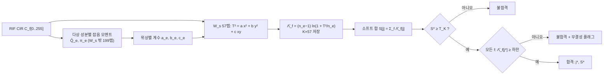

# RIF Λ̂ 판정기 F/W 구현 가이드

고정 칩(프래그먼트마다 RIF CIR 256탭만 얻는 경우)에서 **CIR 추정 Λ̂ 패킷 판정**을 F/W로 구현하기 위한 수식, 설정값, 수치 구현 조건, 확인 절차를 정리합니다.

- **입력:** 프래그먼트마다 RIF CIR `C[k] = x[k] + j·y[k]`, k = 0..255 (LLS 2열 덤프와 같은 정보). 원시 샘플 모멘트(5열 덤프의 Q·Π)는 쓰지 않습니다.
- **검증 상태:** LLS 단계 B 완료(2026-11-16). 오수락 10⁻⁶(FiRa medium)과 감도를 LLS 2열 덤프로 확인했습니다(`DECISIONS.md` "결정 1: LLS 검증", 결과 페이지 `docs/lls.html`).
- **참조 구현:** MATLAB `rif_cir_analyze(..., 'Chip', 'fixed')` → `rif_packet(R)`(기본값: 소프트 결합, 10⁻⁶, 여유 1.5, 하한 1, 이동 후보 0). 이 문서의 식과 상수는 그 코드와 같습니다(부록 A). 3장의 실수 2차형식은 참조 코드의 복소 식과 수치로 같음을 확인했습니다(차이 4e-15).

용어: 다상 성분 e = k mod 8, 신호 창 W_s, 잡음 탭(신호 창 밖), 소프트 합 S, 패킷 = 한 수신기의 거리 측정 1회에 쓰는 RIF 프래그먼트 K개.

---

## 0. 한 장 요약

```
프래그먼트 f마다  (C[k] = x[k] + j·y[k], k = 0..255)
  1) 잡음 모멘트: 다상 성분 e = 0..7마다 잡음 탭 N_e = {k ∉ W_s, k mod 8 = e} (n_e = 25, e = 7만 24)
       Q̂_e = (1/n_e) Σ (x² + y²)
       π_e = u_e + j·v_e,   u_e = Σ (x² − y²) / Σ (x² + y²),   v_e = Σ 2xy / Σ (x² + y²)
       |π_e| > 0.98 이면 π_e ← π_e · 0.98/|π_e|
  2) 위상별 계수:  g_e = 2 / (Q̂_e (1 − |π_e|²)),  a_e = g_e (1 − u_e),  b_e = g_e (1 + u_e),  c_e = −2 g_e v_e
  3) 신호 창 탭 k ∈ W_s = [119, 175] (57개), e = k mod 8:
       T²[k]  = a_e x² + b_e y² + c_e x y
       Λ̂_f[k] = (n_e − 1) · ln(1 + T²[k] / n_e)          ← H0에서 정확히 χ²₂

패킷(프래그먼트 K개)마다
  4) S[j] = Σ_{f=1..K} Λ̂_f[j]  (j ∈ W_s),   S* = max_j S[j],   j* = argmax (같으면 앞 탭)
  5) 수락:  S* ≥ T_K   그리고   모든 f에서 Λ̂_f[j*] ≥ 1
       T_K (W = 57, 이동 후보 1개, 올림) = 36.53 (K=1) / 42.75 (K=2) / 52.82 (K=4) / 69.61 (K=8)
  6) 출력: 수락 여부, 피크 탭 j*, S*, 프래그먼트별 Λ̂_f[j*] (무결성 플래그용)
```



예외 처리(프래그먼트 누락, 잡음 바닥, 포화, NaN, 하한 실패 뒤 다시 판정, 설정 오류), 이동 후보 d, K = 1의 로그 없는 판정까지 넣은 코드는 **부록 B**이고, 예외별 처리 규칙은 5.5절입니다.

---

## 1. 왜 이 판정기인가

| 항목 | 기존 Z 판정기 (피크 / 최대 위상 바닥, 두 단계 문턱) | CIR 추정 Λ̂ 패킷 판정 |
|---|---|---|
| H0 분포 | 채널·CFO·길이에 따라 바뀜 | 탭마다 정확히 χ²₂ (잡음 세기·모양과 무관) |
| 패킷 보장 | 없음. 같은 채널을 겪는 8개의 오검출이 패킷 안에 몰림(B-MD: 3개 이상 통과가 독립 가정의 5배) | 프래그먼트가 H0에서 독립(B-0 쌍 상관 +0.006)이라 패킷 문턱을 닫힌 식으로 정함 |
| 잔여 CFO 0 | 오검출 증가(B-H0-3: 256심볼 −82 dBm 0.94% → 5.88%) | 영향 없음. κ = 1에서는 보수적 |
| 감도 (32심볼, AWGN) | 프래그먼트 L90 −111.90 dBm | 패킷(K = 8) L90 −116.76 dBm (4.9 dB 좋음) |

Λ̂는 같은 다상 성분의 잡음 탭으로 그 프래그먼트의 잡음 세기(Q̂)와 모양(Π̂)을 재고, 신호 창의 각 탭을 그 잡음으로 백색화한 값입니다. 백색화한 값의 분포가 잡음 조건과 무관하게 고정되므로 문턱을 미리 계산한 상수로 둘 수 있습니다.

---

## 2. 입력과 설정값

| 이름 | 값 | 뜻 | 근거·검증 |
|---|---|---|---|
| CIR | `C[k]`, k = 0..255, 복소 정수 | 프래그먼트마다 하나 | LLS 덤프 값은 정수. 반올림 잡음의 몫 1.6e-5 (B-0) |
| 주기 P | 8 | HPRF 펄스 간격(다상 성분 수) | BPRF는 16이지만 검증 안 됨 |
| 신호 창 W_s | [119, 175], W = 57 | 피크(첫 경로) 후보 탭 | LLS 피크 탭 125 (설계 기본 127) |
| 잡음 탭 N_e | W_s 밖 전부 (199탭) | 위상 e의 잡음 표본 | n_e = 25 (e = 0..6), 24 (e = 7) |
| RhoMax | 0.98 | 비원형 계수 \|π\| 상한 | B-H0-3 (κ = 1에서 보수적) |
| PfaTarget | 10⁻⁶ | 패킷 오수락 목표 | 결정 1·2 |
| Margin | 1.5 | 문턱 여유 (목표/1.5로 설계) | 단계 B 꼬리 비율 ≈ 1 |
| K | 1 / 2 / 4 / 8 | 패킷당 RIF 프래그먼트 수 (NumRIF = 4 → 8) | B-H1 (8개), B-1R (1·2·4개) |
| 이동 후보 d | LLS: {0} | 패킷 안 피크 이동 탐색 | silicon 미정 (4.2절, 결정 5) |
| 하한 F_floor | 1 (임시) | 선택 경로에서 프래그먼트별 최소 Λ̂ | B-F·B-S. 결정 6 안 3으로 바꿀 예정 (4.5절) |
| 잡음 바닥 최솟값 Q_MIN | 4 LSB² | 위상별 Q̂_e가 이보다 작으면 판정 불가 | 정수 CIR 시뮬레이션 (5.5절, 제안) |
| 포화 코드 SAT | 부호 있는 N비트 CIR이면 2^(N−1) − 1 (HW 포화 플래그가 있으면 그것을 씀) | 잡음 탭이 잘리면 판정 불가, 신호 창 탭만 잘리면 정보 플래그 | 제안 (5.5절). 0이면 검사 안 함. LLS 단계 B에는 포화 조건이 없었음 |
| 용도 | 보안 판단 / 일반 용도 | 걸렸을 때 폐기 / 빼고 다시 판정 | 결정 7 (세션 설정) |
| m_max | K = 8: 2, K = 2·4: 1, K = 1: 0 | 일반 용도에서 뺄 수 있는 최대 프래그먼트 수 | 결정 7 제안 |

**신호 창과 잡음 탭을 정할 때**

- W_s는 기대 피크 위치(타이밍 불확실성 포함)를 모두 덮어야 합니다. 넓히면 문턱이 오릅니다(K = 8: W = 114이면 71.32, 약 0.25 dB 손해).
- 잡음 탭에는 신호(멀티패스 꼬리 포함)가 없어야 합니다. 신호가 섞이면 Q̂가 커져 감도가 떨어지고 Π̂가 틀어집니다.
- 잡음 탭은 W_s 밖을 **모두** 씁니다. 표본이 줄면 추정 잡음 때문에 문턱 상승이 커집니다(n = 25: 알려진 잡음 대비 약 2.4 dB, n = 10: 약 7.0 dB).
- W_s를 바꾸면 n_e도 다시 셉니다(설정마다 정해지는 상수). 아래 식은 모두 위상별 n_e를 씁니다.

---

## 3. 프래그먼트 처리

### 3.1 다상 성분별 잡음 모멘트

HPRF CIR에서 탭 k = 127 + 8m + e의 H0 값(열잡음과 틀린 키 신호의 자기잡음)은 위상 e의 펄스 모양에 서로 독립인 랜덤 합을 곱한 것입니다. 그래서 같은 위상의 탭은 위치와 무관하게 같은 분포를 따르고 서로 독립입니다(주기정상 잡음). 위상마다 세기가 다르므로(위상 간 바닥비 D) 모멘트는 **위상별로** 잽니다.

```
Q̂_e = (1/n_e) Σ_{k∈N_e} |C[k]|²          (잡음 세기)
Π̂_e = (1/n_e) Σ_{k∈N_e} C[k]²             (잡음 모양, 의사 분산)
π_e = Π̂_e / Q̂_e,   |π_e| ≤ 1               (비원형 계수, κ와 같은 성질)
```

실수 연산으로는 `C² = (x² − y²) + j·2xy`이므로 세 합 `Σ(x² + y²)`, `Σ(x² − y²)`, `Σ 2xy`만 누적하면 됩니다. π_e는 비율이라 1/n_e가 지워집니다.

### 3.2 비원형 보정과 상한

- 잔여 CFO가 작으면 틀린 키 신호의 자기잡음이 반송파 위상으로 돌지 않아 잡음이 복소평면의 한 방향으로 몰립니다(|π| → 1, B-H0-3에서 잔여 CFO 0이면 길이와 무관하게 κ = 1). Π̂를 빼고 원형 잡음으로 가정하면 이 조건에서 오검출이 늘어납니다.
- |π_e| > 0.98이면 크기만 0.98로 줄입니다(방향 유지): `π_e ← π_e · 0.98/|π_e|`. κ = 1에서 Λ̂가 χ²₂보다 작아지므로 보수적입니다(LLS −40 dBm 탭 꼬리 비율 0.20~0.77, κ = 1 합성 잡음 0.14~0.28).

### 3.3 탭 통계량 T² (2×2 백색화)

복소 식(참조 코드 `lambda_stat`):

```
T²[k] = 2 (|C[k]|² − Re(π_e* · C[k]²)) / (Q̂_e (1 − |π_e|²))
```

실수 2차형식(구현용, 같은 값):

```
g_e = 2 / (Q̂_e (1 − u_e² − v_e²))
a_e = g_e (1 − u_e),   b_e = g_e (1 + u_e),   c_e = −2 g_e v_e
T²[k] = a_e x[k]² + b_e y[k]² + c_e x[k] y[k]
```

- 탭 (x, y)를 잡음 공분산 추정값으로 백색화한 마할라노비스 거리입니다. |π| < 1이면 양의 정부호라 T² ≥ 0입니다.
- 위상별 계수 3개를 프래그먼트마다 한 번 계산하면, 탭마다 곱셈 5번과 덧셈 2번입니다. 나눗셈은 위상당 1번입니다.
- H0에서 T²는 Hotelling 분포를 따릅니다: `P(T² ≥ t) = (1 + t/n)^(−(n−1)/2)` (n → ∞이면 e^(−t/2)). 잡음을 n개 표본으로 추정했기 때문에 χ²₂보다 꼬리가 두껍습니다.

### 3.4 χ²₂ 환산 Λ̂

```
Λ̂[k] = (n_e − 1) · ln(1 + T²[k] / n_e)          H0: P(Λ̂ ≥ λ) = e^(−λ/2)  (정확히 χ²₂)
```

- 이 변환은 Hotelling 꼬리를 정확히 χ²₂로 바꿉니다. 그래서 K개의 합이 H0에서 χ²_{2K}를 따르고, 패킷 문턱을 닫힌 식(4.3절)으로 정할 수 있습니다. 변환하지 않은 T²를 더하면 꼬리가 두꺼워 같은 문턱에서 오수락이 목표를 넘습니다.
- Λ̂는 잡음 통계까지 추정하는 문제의 일반화 우도비 2·ln GLR = (n+1)·ln(1 + T²/n)의 (n−1)/(n+1)배입니다(`docs/glr.html`).
- 신호가 강하면 로그 때문에 값이 눌립니다(예: T² = 1000이면 Λ̂ ≈ 89). 판정은 문턱 근처만 중요하므로 문제없지만, 신호 크기 추정에 Λ̂를 그대로 쓰면 안 됩니다(4.5절).
- **K = 1이면 로그가 필요 없습니다.** `Λ̂ ≥ T` ⇔ `T² ≥ n_e (e^(T/(n_e−1)) − 1)`이므로 위상별 T² 문턱(T = 36.53에서 n_e = 25: 89.55, n_e = 24: 93.49, 올림)과 비교하면 됩니다. 위상 안에서는 Λ̂가 T²에 단조이므로 피크 위치와 출력용 Λ̂도 위상별 최대 T² 8개만 로그를 취하면 정확히 나옵니다(부록 B).

### 3.5 F/W에 유리한 성질

- **스케일 무관:** C 전체에 상수를 곱해도 T²와 Λ̂는 그대로입니다. 프래그먼트마다 AGC 이득이 달라도(LLS AGC 표준편차 2.8 dB) 정규화가 필요 없습니다.
- **프래그먼트마다 독립 추정:** Q̂·Π̂는 프래그먼트마다 새로 잽니다. 패킷의 여러 프래그먼트에서 모으면 반송파 위상이 달라 유효 표본이 줄고 감도가 0.4~1.4 dB 나빠집니다(결정 9).
- **로그와 T²는 신호 창 57탭만:** 잡음 탭 199개는 모멘트 누적에만 씁니다.

---

## 4. 패킷 판정

### 4.1 패킷 구성

- 한 수신기의 한 거리 측정에 쓰는 RIF 프래그먼트 K개(시간 순 f = 1..K)가 한 패킷입니다. NumRIF = 4면 K = 8입니다.
- STS가 심볼마다 바뀌어 H0에서 프래그먼트는 서로 독립입니다(B-0: 쌍 상관 +0.006, 기준 ±0.0125).
- 패킷의 프래그먼트가 K개보다 적으면(누락) 참조 코드는 그 패킷을 버립니다. F/W는 없는 프래그먼트를 판정 불가로 표시하고, 보안 판단이면 폐기, 일반 용도면 남은 개수의 문턱으로 판정합니다(5.5절).

### 4.2 소프트 합과 이동 후보

```
S_d[j] = Σ_{f=1..K} Λ̂_f[ j + round(d · (f − 1)) ]       (경로의 모든 탭이 W_s 안인 j만)
S* = max_{d, j} S_d[j]
```

- 경로 하나가 프래그먼트마다 같은(또는 이동한) 탭을 더합니다. H0에서 S_d[j]는 χ²_{2K}입니다.
- **LLS (검증 조건):** 이동 후보 d = 0 하나. LLS는 RIF 시작점을 설정 오프셋으로 옮겨 피크가 1탭 폭 톱니 안에 머뭅니다(B-0). 이 소수 탭 어긋남의 손해(L90 약 0.5 dB, L99 약 1 dB)는 단계 B 감도에 이미 들어 있습니다.
- **silicon (미정, 결정 5):** 오프셋을 어떻게 추정하고 쓸지에 따라 후보 수가 정해집니다.

| silicon 방식 | 패킷 안 피크 이동 | 이동 후보 |
|---|---|---|
| 시작점을 옮기지 않음 | 오프셋 × RIF 간격만큼 계속 밀림 (1 ms 간격이면 1 ppm당 약 1탭) | 후보 간격 1/(K−1), 범위는 최대 오프셋 (±0.5 ppm, K = 8이면 9개) |
| 추정 오프셋으로 시작점을 옮김 | 1탭 톱니 + 추정 오차만큼 밀림 | 오차 ≤ 약 0.07 ppm이면 1개, 넘으면 오차 범위만큼 |
| 정답에 가까운 오프셋으로 옮김 (LLS와 같음) | 1탭 톱니 | 1개 |

### 4.3 문턱

```
W · N_d · P(χ²_{2K} > T) = PfaTarget / Margin
P(χ²_{2K} > T) = e^(−T/2) · Σ_{i=0..K−1} (T/2)^i / i!
K = 1:  T = 2 ln(W / PfaTarget) + 2 ln(Margin)
```

탭 57개 × 후보 N_d개의 경로에 대한 합집합 상한입니다. F/W는 설정별 상수로 둡니다(W = 57, 10⁻⁶, 여유 1.5).

| K \ N_d | 1 | 3 | 7 | 9 |
|---|---|---|---|---|
| 1 | 36.53 | (해당 없음) | | |
| 2 | 42.75 | 45.05 | 46.81 | 47.34 |
| 4 | 52.82 | 55.28 | 57.17 | 57.73 |
| 8 | **69.61** | 72.33 | 74.41 | 75.02 |

- 상수는 **올림**으로 저장합니다(내림은 오수락을 늘림. K = 8에서 0.25 내리면 오수락 1.04배). 표는 소수 둘째 자리 올림 값이라, 다른 문서의 반올림 표기(K = 2: 42.74)와 0.01 다를 수 있습니다.
- W, N_d, 목표를 바꾸면 위 식으로 다시 계산합니다(참조 코드 `soft_threshold`, 이분법).

### 4.4 하한 검사 (현재 구현)

```
수락 조건에 추가:  모든 f에서 Λ̂_f[ j* + round(d* (f − 1)) ] ≥ F_floor  (F_floor = 1)
```

- "프래그먼트 하나라도 비어 있으면 폐기"의 첫 단계입니다. H0에서는 조건을 하나 더 거는 것이라 오수락을 늘리지 않습니다.
- 바꿔치기(빈 프래그먼트)의 Λ̂는 그 탭에서 χ²₂이므로 그 패킷을 버릴 확률은 1 − e^(−F/2) = 39.3%입니다(LLS B-S 38%).
- 비용: 패킷 L90 0.18~0.34 dB (B-F).

### 4.5 일관성 검사 안 3 (결정 6, 잠정, 도구 미구현)

목표: 맞는 키 패킷이 검사 때문에 버려지는 비율을 **모든 세기에서 0.1%**로 두고, 강한 신호에서는 바꿔치기를 거의 모두 잡습니다(+6.5 dB에서 약 99%).

Λ̂로 구현할 때는 신호 크기 추정과 분위수를 **Λ̂(또는 T²) 영역에서** 만들어야 합니다. 설계 페이지의 비중심 χ²₂ 분위수는 잡음을 아는 Λ 기준이라, 강한 신호에서 로그로 눌리는 Λ̂에 그대로 쓰면 틀립니다. 아래는 그 변환 제안입니다(미검증).

```
H1에서 T²의 분포 (같은 다상 성분의 잡음 표본 n개, 신호 크기 λ):
    (n − 1)/(2n) · T² ~ 비중심 F(2, n − 1; λ),     E[T²] = n (2 + λ) / (n − 3)
선택 경로에서 프래그먼트별 T²를 되돌림:  T²_f = n (e^(Λ̂_f/(n−1)) − 1)
신호 크기 추정:   λ̂ = max(0, (n − 3)/n · mean_f T²_f − 2)
하한 (LUT):      F(λ̂) = (n − 1) · ln(1 + 2 q / (n − 1)),   q = 비중심 F(2, n−1; λ̂)의 p 분위수,   p = 1 − 0.999^(1/K)
```

T²의 H1 분포가 비중심 F임은 몬테카를로로 확인했습니다(n = 25, λ = 0~100에서 분위수 10⁻³~0.9가 1% 안, 평균식 일치). 예시 LUT(n = 25):

| λ (프래그먼트당) | 0 | 10 | 20 | 40 | 80 | 160 |
|---|---|---|---|---|---|---|
| F (Λ̂ 영역), K = 8 | 0.00 | 0.04 | 0.98 | 5.76 | 15.22 | 28.09 |
| 참고: Λ 영역(잡음 앎), K = 8 | 0.00 | 0.04 | 1.07 | 7.73 | 28.66 | 81.61 |
| F (Λ̂ 영역), K = 4 | 0.00 | 0.07 | 1.31 | 6.42 | 16.06 | 28.99 |
| F (Λ̂ 영역), K = 2 | 0.00 | 0.13 | 1.70 | 7.15 | 16.96 | 29.95 |

- K = 8 소프트 합의 L90은 프래그먼트당 λ ≈ 9.6입니다. 감도 부근에서는 하한이 거의 0이라 정상 패킷을 버리지 않습니다(그 영역의 빈 프래그먼트는 오수락 10⁻⁶을 깨지 못함, 결정 6).
- 구현 전에 도구에 넣고 LLS로 정상 폐기율 0.1%와 바꿔치기 탐지를 다시 재야 합니다(B-F·B-S를 같은 코드로, 결정 6 "아직 하지 않은 것").

### 4.6 걸렸을 때의 처리 (결정 7)

| 용도 (세션 설정) | 처리 | 보고 |
|---|---|---|
| 보안 판단: 출입, 결제, 거리 기반 인증 | 그 측정 폐기 | STS 실패 상태 + 무결성 플래그 |
| 일반 용도: 측위, 추적, 보정 | 걸린 프래그먼트 m개를 빼고 K − m개로 다시 판정 | 측정값 + 무결성 플래그 |

뺄 때의 문턱: 어느 m개를 뺄지 값을 보고 고르므로 선택 수 C(K, m)을 합집합 상한에 곱합니다.

```
W · N_d · C(K, m) · P(χ²_{2(K−m)} > T_{K,m}) = PfaTarget / Margin
```

| (N_d = 1) | K = 2, m = 1 | K = 4, m = 1 | K = 4, m = 2 | K = 8, m = 1 | K = 8, m = 2 |
|---|---|---|---|---|---|
| T_{K,m} | 37.92 | 51.03 | 46.49 | 70.67 | 69.39 |

- 빼는 근거는 검사에 걸린 사실뿐입니다. 합을 최대로 만드는 선택 등 다른 기준으로 고르지 않습니다.
- 미정: 최대 m(제안: K = 8이면 1~2, K = 2·4면 1), 세션 설정 이름과 기본값(제안: 보안 판단 = 폐기), 플래그 형식. RIF 1개 구성에는 이 검사가 없습니다.

### 4.7 출력

| 출력 | 뜻 |
|---|---|
| 수락 여부 | S* ≥ T 그리고 하한(또는 일관성) 검사 통과 |
| 피크 탭 | 119 + j* (LLS 피크 125). 소프트 합의 argmax이며 첫 경로가 아닐 수 있음 |
| S*, d* | 소프트 합과 선택한 이동 후보 (진단, 신호 크기 추정) |
| Λ̂_f[j*] | 프래그먼트별 값 (무결성 플래그에 어느 프래그먼트인지 표시) |

- **ToA:** 피크 탭은 \|C\|²나 Λ̂의 최대 위치입니다. 멀티패스(주거 LOS)에서 첫 경로 125 ± 2 안에 들어오는 비율은 0.42~0.46입니다(B-H1-3). ToA에는 별도의 첫 경로 탐색이 필요하고, 탭마다 χ²₂인 Λ̂는 그 문턱 설계의 근거로 쓸 수 있습니다.

---

## 5. 수치 구현

### 5.1 연산 형식

- **float32 권장.** float64와의 차이는 Λ̂ 최대 1.5e-6입니다(합성 CIR로 확인). 비원형 보정 분자는 |π| ≤ 0.98에서 최대 약 50배 상쇄(6비트)라 float32 가수 24비트로 충분합니다.
- **고정소수점(FPU 없음):** 모멘트 합은 입력 비트의 2배 + 5비트(199탭)가 필요합니다. 스케일 무관이므로 프래그먼트마다 블록 지수(최대 Q̂_e 기준 시프트)를 써도 됩니다. 계수 a·b·c와 T²는 블록 부동소수점, ln은 표(5.3절)로 둡니다. 비트폭은 미정입니다(설계 문서 10장).

### 5.2 정밀도 예산

프래그먼트마다 Λ̂에 같은 방향의 오차 δ가 있으면 패킷 오수락이 늘어납니다(문턱 근처, 여유 1.5 중 사용분):

| 프래그먼트당 Λ̂ 오차 δ | 0.01 | 0.05 | 0.1 | 0.25 |
|---|---|---|---|---|
| 오수락 배수, K = 8 | 1.03 | 1.18 | 1.38 | 2.23 |
| 오수락 배수, K = 4 | 1.02 | 1.09 | 1.20 | 1.56 |
| 오수락 배수, K = 1 | 1.005 | 1.03 | 1.05 | 1.13 |

**목표: 같은 방향 오차 |δ| ≤ 0.01** (여유 1.5의 5% 이하 사용).

### 5.3 ln 구현

| 방법 | Λ̂ 최대 오차 (n − 1 = 24배) |
|---|---|
| `log1pf` (float32) | 1e-6 이하 |
| log₂ 지수 분리 + 가수 표 32칸 + 선형 보간 | 0.0028 (목표 안) |
| 같은 방식 16칸 | 0.011 (경계) |
| 같은 방식 64칸 | 0.0007 |

- 작은 T²에서 `logf(1 + x)`는 상대 오차가 커지지만 Λ̂ 절대 오차는 작아 판정에는 영향이 없습니다. `log1pf`가 있으면 그것을 씁니다.

### 5.4 연산량과 메모리 (프래그먼트 하나)

| 단계 | 연산 |
|---|---|
| 모멘트 | 잡음 탭 199개 × (제곱 2, 곱 1, 덧셈 3) |
| 위상 계수 | 8위상 × (나눗셈 2~3, 곱 약 8, 비교 1, 필요 시 제곱근 1) |
| Λ̂ | 신호 창 57탭 × (곱 5, 덧셈 2, 상수 곱 2, ln 1) |
| 패킷 (N_d = 1) | 57 × K 덧셈, 최댓값 탐색 57, 하한 비교 K |

- 저장: Λ̂_f[57] × K (K = 8, float32이면 1,824바이트). 하한·일관성 검사와 빼고 다시 판정(4.6절)에 프래그먼트별 값이 필요하므로 합만 누적하지 말고 K×57을 남깁니다.
- 시점: 프래그먼트 처리는 그 CIR이 나오면 바로 하고, 패킷 판정은 마지막 프래그먼트 뒤에 합니다.

### 5.5 예외 처리 (제안: 시뮬레이션 근거, LLS·silicon 미확인)

부록 B의 코드가 아래 규칙대로 처리합니다.

| 경우 | 검사 위치 | 플래그 | 처리 |
|---|---|---|---|
| CIR 없음 (수신 실패, 시간 초과, 패킷의 프래그먼트 수 부족) | 프래그먼트 입력 | `FF_MISSING` | 판정 불가 |
| 어느 위상이든 Q̂_e < Q_MIN (0, NaN 포함) | 모멘트 누적 뒤 | `FF_LOWNOISE` | 판정 불가 |
| 잡음 탭 포화 (\|x\| 또는 \|y\| ≥ 포화 코드) | 모멘트 누적 중 | `FF_SAT_NOISE` | 판정 불가 |
| T² 또는 Λ̂가 NaN/Inf (고정소수점이면 누산기 포화도) | 신호 창 계산 | `FF_NUMERIC` | 판정 불가 |
| 신호 창 탭 포화 | 모멘트 누적 중 | `FF_SAT_SIG` | 정보만, 판정은 함. 신호 창에서만 잘리는 것은 맞는 키의 센 피크일 때뿐 (아래 "포화 처리") |
| \|π_e\| > 0.98 | 위상 계수 | `FF_RHO_CLAMP` | 정보만. 잔여 CFO ≈ 0의 정상 경로 (3.2절) |
| 선택 경로에서 Λ̂_f < 하한 | 패킷 | `FF_FLOOR` | 보안 판단: 폐기. 일반 용도: 빼고 한 번 다시 판정 |
| 피크가 신호 창 끝 탭 | 패킷 | `edge` | 정보만. 창 배치(타이밍) 확인 |
| 설정 오류 (창 범위, 위상당 잡음 탭 < 5, K, 이동 후보 수, 인자 범위) | 설정 | `RIF_ECFG_*` | 판정하지 않음 |

**잡음 바닥 최솟값 Q_MIN = 4 LSB²**

- 참조 코드는 `max(Q, realmin)`이라, 한 위상의 잡음 탭이 모두 0이고 신호 창 탭에 값이 있으면 Λ̂가 거의 무한대가 됩니다(오수락). 0이 아니어도 너무 작으면 반올림 때문에 잡음이 몇 개의 정수 값만 가져 χ²₂ 전제가 깨집니다.
- 정수 CIR 시뮬레이션 (원형 가우스 잡음, 프래그먼트 20,000개, H0 탭 꼬리 비율 `P(Λ̂ ≥ t) / e^(−t/2)`):

| 성분당 잡음 σ [LSB] | Q̂ [LSB²] | t = 10 / 14 / 18 | 판단 |
|---|---|---|---|
| 0.35 | 0.41 | 7.3 / 34 / 91 | 위험 |
| 0.5 | 0.67 | 1.2 / 2.1 / 3.5 | 위험 |
| 0.75 | 1.29 | 0.95 / 0.94 / 1.06 | 정상 |
| 1.0 | 2.17 | 1.00 / 0.95 / 1.07 | 정상 |
| 2.0 | 8.17 | 1.00 / 0.98 / 0.97 | 정상 |

- Q_MIN = 4는 위험 구간(≤ 0.7)보다 약 6배, 정상 경계(1.3)보다 약 3배 위입니다. LSB는 CIR 정수 값의 한 칸(고정소수점이면 양자화 간격)입니다.
- 정상 동작에서는 걸리지 않아야 합니다. LLS 덤프의 반올림 잡음 몫(1/6 LSB² ÷ Q̂_e)은 1.6e-5로, 위험 구간의 몫(0.25 이상)보다 네 자릿수 작습니다. silicon에서 Q̂_e가 이 경계에 가까우면 Q_MIN을 낮추지 말고 CIR 출력 시프트를 줄입니다.
- Q̂_e를 Q_MIN으로 올려 계산하는 방법은 오수락 쪽으로는 안전하지만 비정상 상태를 숨기고 그 프래그먼트를 조용히 버리게 되므로 쓰지 않습니다.

**포화 처리 (SAT)**

```text
for k = 0..255:
    SAT > 0 이고 (|x[k]| ≥ SAT 또는 |y[k]| ≥ SAT) 이면:
        ws0 ≤ k ≤ ws1 (신호 창)  → FF_SAT_SIG     정보만, 판정은 함
        그 밖 (잡음 탭)          → FF_SAT_NOISE   판정 불가
```

- **SAT는 데이터가 아니라 CIR 출력 형식에서 정하는 상수입니다.** 부호 있는 N비트 정수면 2^(N−1) − 1(16비트면 32767)입니다. HW가 CIR 누적기의 포화 플래그를 주면 코드값 비교 대신 그것을 씁니다. 0이면 검사하지 않습니다. 한 프래그먼트에 두 플래그가 함께 붙을 수 있습니다.
- **잡음 탭 포화는 판정 불가입니다.** Q̂_e와 π_e를 그 탭에서 재므로, 잘리면 잡음 추정이 틀어져 χ²₂ 보장이 없습니다. 잡음 탭이 포화될 정도면 강한 간섭, AGC 이상, 신호 창 밖의 신호 같은 비정상 상태이기도 합니다.
- **신호 창 탭만 포화되면 정보 플래그만 남깁니다.** H0(틀린 키, 재밍)에서는 에너지가 위상마다 모든 탭에 고르게 퍼지므로, 신호 창 탭이 포화될 만큼이면 잡음 탭도 포화되어 위 규칙으로 판정 불가가 됩니다. 신호 창에서만 포화되는 것은 맞는 키의 센 피크(H1)일 때이고, 그때 Λ̂는 문턱보다 훨씬 커서 판정이 바뀌지 않습니다.
- **잘린 탭의 Λ̂가 작아진다고 볼 수는 없습니다.** 원형 잡음에서는 작아지지만, 비원형 잡음에서 한 성분만 잘리면 T²가 커질 수 있습니다. 예: π = 0.90 + j0.39 (|π| = 0.98)에서 (x, y) = (3, 1)·SAT가 (1, 1)·SAT로 잘리면 T²가 23.7에서 61.7로 2.6배가 됩니다(원형 잡음이면 20에서 4로 작아짐). 그래서 신호 창 포화를 판정에 쓰는 근거는 위의 "H0면 잡음 탭도 포화된다"입니다.
- LLS 단계 B에는 포화 조건이 없었습니다. LLS 덤프에 포화가 있는지는 가장 센 H0 덤프에서 \|x\|, \|y\|의 최댓값이 여러 번 반복되는지로 봅니다(반복되면 그 값이 포화 코드).

```matlab
R = rif_cir_analyze('D:/rif/h0_awgn/c32_m40_j1/bin', 'Plot', 'none', 'Quiet', true, 'Chip', 'fixed');
v = [abs(real(R.C(:))); abs(imag(R.C(:)))];
fprintf('max |x|,|y| = %d, 그 값이 나온 횟수 = %d\n', max(v), sum(v == max(v)));
```

**판정 불가와 하한 실패의 패킷 처리**

| 용도 | 판정 불가 m개 | 하한 실패 m개 |
|---|---|---|
| 보안 판단 | 폐기 (`PKT_REJECT_INVALID`) | 폐기 (`PKT_REJECT_FLOOR`) |
| 일반 용도 | m ≤ m_max면 빼고 kv = K − m개로 판정, 문턱 T[kv][0] | 빼고 한 번만 다시 판정, 문턱 T[kv][m] (C(kv, m) 보정). 남은 것도 하한 검사 |

- **판정 불가는 C(K, m) 보정이 없습니다.** 그 프래그먼트 자신의 잡음 탭이나 입력 상태만 보고 정한 것이라, 남은 kv개의 합은 H0에서 그대로 χ²_{2kv}입니다.
- **하한 실패는 값을 보고 빼므로 보정합니다**(결정 7). 다시 판정은 먼저 T[kv][0]을 넘은 패킷에서만 일어나므로, 다시 판정을 더해도 패킷 오수락은 T[kv][0]의 목표(10⁻⁶ / 1.5) 안에 있습니다.
- 두 경우를 합쳐 뺀 수가 m_max를 넘으면 폐기합니다. 하한 실패로 3개 이상 빼야 하면 폐기합니다(문턱표 크기).
- K = 1 구성에는 하한 검사가 없고, 판정 불가면 쓸 프래그먼트가 없어 `PKT_REJECT_NODATA`입니다.

문턱표 T[kv][m] (W = 57, 이동 후보 1개, 10⁻⁶, 여유 1.5, 올림). 이동 후보가 여러 개면 `rif_init`이 같은 식으로 계산합니다(남은 수 1이면 이동 후보 수를 곱하지 않음).

| kv \ m | 0 | 1 | 2 |
|---|---|---|---|
| 1 | 36.53 | | |
| 2 | 42.75 | 37.92 | |
| 3 | 48.03 | 45.05 | 38.73 |
| 4 | 52.82 | 51.03 | 46.49 |
| 5 | 57.31 | 56.42 | 53.01 |
| 6 | 61.57 | 61.43 | 58.86 |
| 7 | 65.66 | 66.15 | 64.28 |
| 8 | 69.61 | 70.67 | 69.39 |

**그 밖에**

- **같은 값의 최댓값:** 참조 코드(MATLAB `max`)는 앞 탭을, 이동 후보도 앞의 후보를 고릅니다. 비교에 `>`를 써서 맞춥니다.
- **반올림 규칙:** 이동 후보의 탭 이동 `round(d·f)`는 MATLAB처럼 0.5를 0에서 먼 쪽으로 올립니다(C `lroundf`).

### 5.6 자주 틀리는 곳

| 실수 | 결과 |
|---|---|
| 잡음 모멘트를 위상 구분 없이 평균 | 위상별 잡음 세기 차이(D)를 놓쳐 오검출이 늘어남 |
| Π̂(π)를 빼고 원형 잡음으로 계산 | 잔여 CFO가 작을 때 오검출이 늘어남 |
| 잡음 탭에 신호 창 탭이나 멀티패스 꼬리가 섞임 | Q̂가 커져 감도 손해, π가 틀어짐 |
| 잡음 탭 수를 줄임 | 추정 잡음 때문에 문턱 상승 (n = 10이면 약 7 dB) |
| 모멘트를 패킷의 여러 프래그먼트에서 모음 | 감도 0.4~1.4 dB 손해 (결정 9) |
| n_e를 모든 위상에 25로 씀 | e = 7은 24. Λ̂ 분포가 조금 어긋남 |
| T²를 그대로 더함 (χ²₂ 환산 생략) | 합의 꼬리가 두꺼워 오수락이 목표를 넘음 |
| 문턱을 내림으로 저장 | 오수락 증가 |
| Λ̂의 합으로 신호 크기를 추정해 비중심 χ² 표를 씀 | 강한 신호에서 하한이 틀림 (4.5절) |

---

## 6. 검증된 성능 (LLS 단계 B, 2026-11-16)

**감도 (AWGN, 패킷 소프트, 하한 1, 이동 후보 0)**

| RIF 길이 | 32 | 64 | 128 | 256 |
|---|---|---|---|---|
| K = 8 L90 [dBm] | −116.76 | −119.69 | −122.08 | −121.61 |
| K = 8 L99 [dBm] | −115.33 | −118.08 | −120.25 | −120.30 |
| K = 4 L90 | −114.23 | −117.16 | −119.38 | −119.15 |
| K = 2 L90 | −111.26 | −114.11 | −116.45 | −116.19 |
| K = 1 L90 | −107.04 | −110.01 | −112.23 | −111.95 |
| 참고: Z 프래그먼트 L90 | −111.90 | −114.76 | −117.13 | −116.76 |

- 모델과의 차이: K = 8은 0.2 dB 안, K = 1·2·4는 모델보다 0.3~0.8 dB 좋음.
- 위치 정확도(AWGN, 피크 125 ± 3): 98% 이상(B-1R 1.000).
- 멀티패스(주거 LOS, 32심볼, K = 8): L90 −109.07, L99 −104.50 dBm (AWGN보다 6.5~7.7 dB 나쁨. 탭 하나로 보는 판정기의 한계).

**오수락**

| 시험 | 조건 | 결과 |
|---|---|---|
| B-H0 | AWGN 23개 조건 (32~256심볼, −40 ~ −120 dBm) | 수락 0, 소프트 꼬리 비율 0.97 / 0.92 (1e-2 / 1e-3) |
| B-H0-4 | 같은 채널 멀티패스, −40·−82 dBm, 각 30,000개 | 수락 0, 꼬리 비율 0.95~1.15 |
| B-H0-3 | 잔여 CFO 0, 32·256심볼 | 수락 0, Λ̂ 꼬리 −82 dBm 0.97~1.06, −40 dBm 0.20~0.77 (보수적) |
| B-1R | K = 1·2·4, 165,000개 | 수락 0, 쌍 상관 ≤ 0.028 |

**감시 항목 (선택 확장):** B-1R RIF 4개 −40 dBm 128·256심볼의 깊은 꼬리(t = 32에서 비율 2.41 / 1.81), B-H0-3 잔여 CFO 0의 양의 쌍 상관(256심볼 −40 dBm +0.077).

---

## 7. F/W 구현 확인 절차

### 7.1 참조 코드와 값 비교 (호스트에서, LLS 덤프)

F/W 함수(C)를 호스트에서 LLS 2열 덤프에 돌리고 MATLAB 결과와 비교합니다.

```matlab
R = rif_cir_analyze('D:/rif/h1_awgn/c32_m110_j1/bin', 'Plot', 'none', 'Quiet', true, 'Chip', 'fixed');
P = rif_packet(R, 'FragPerPacket', 8);        % 소프트, 10^-6, 여유 1.5, 하한 1, 이동 후보 0
% 프래그먼트 i:  R.Lam_W(:, i)  = Λ̂_f[119..175],  R.Lmax(i), R.kL(i) = 최대값과 탭
% 패킷 q:       P.stat(q) = S*,  P.kSel(q) = 피크 탭,  P.valid(q) = 수락,  P.T = 문턱
```

| 비교 | 기준 |
|---|---|
| Λ̂_f[k] (57탭 × 모든 프래그먼트) | float32: 최대 차이 ≤ 1e-3, ln 표: ≤ 0.01 |
| 프래그먼트 최대 탭 | 같음 (값이 거의 같은 탭은 예외) |
| S*, 피크 탭, 수락 | 같음 (\|S* − T\| < 0.05인 패킷은 예외로 따로 봄) |

덤프 세트: `h0_awgn`(수락 0), `h1_awgn`(감도), `h0_cfo0`(π 상한 경로), `h0_mp`·`h1_mp`(멀티패스).

### 7.2 통계 확인 (F/W 출력으로)

- H0 탭 꼬리 비율 `P(Λ̂ ≥ t) / e^(−t/2)`, t = 10·14: AWGN에서 0.8~1.2 (LLS 0.8~1.1).
- H0 패킷 소프트 합 꼬리 `P(S ≥ t) / (W · P(χ²_{2K} > t))`, 1e-2·1e-3: 1 근처.
- H1 패킷 L90: 6장 표 ±0.3 dB.

### 7.3 silicon에서 할 일

- 패킷 안 피크 이동을 B-0처럼 재고(강한 신호, 프래그먼트별 피크 탭의 기울기와 잔차) 4.2절 표로 이동 후보를 정합니다. 후보가 늘면 4.3절 표의 N_d 열을 씁니다.
- silicon CIR의 W_s 위치(기대 피크 탭)와 잡음 탭에 신호가 없는지 확인합니다.
- 반올림 잡음의 몫과 Q̂_e 최솟값(5.5절)을 확인합니다.
- CIR 출력 비트폭(또는 HW 포화 플래그)으로 포화 코드 SAT를 정하고, 센 맞는 키 신호(근거리)와 센 간섭에서 `FF_SAT_SIG`·`FF_SAT_NOISE`가 얼마나 생기는지 봅니다(5.5절 "포화 처리").

---

## 8. 미정 항목 (F/W 관점)

| 항목 | 상태 | 관련 |
|---|---|---|
| 이동 후보 (silicon 오프셋 처리) | 미정 | 결정 5 |
| 일관성 검사 안 3의 Λ̂ 영역 LUT | 제안(4.5절), 도구 구현과 LLS 재측정 필요 | 결정 6 |
| 걸린 프래그먼트 처리의 세부 (최대 m, 설정, 플래그 형식) | 미정 | 결정 7 |
| 예외 처리 규칙 (Q_MIN = 4 LSB², 잡음 탭 포화, 판정 불가 제외) | 제안 (5.5절, 시뮬레이션 근거). LLS·silicon에서 Q̂_e 분포와 포화 빈도 확인 필요 | 5.5절 |
| 고정소수점 비트폭 (FPU가 없을 때) | 미정 | 설계 문서 10장 |
| BPRF (주기 16) | 검증 안 됨 | 설계 문서 10장 |
| 거리 ≠ 0의 W_s 배치 | 타이밍 불확실성만큼 넓힘 (2배면 약 0.25 dB) | 설계 문서 10장 |
| 첫 경로 탐색 (ToA) | 별도 과제 | 4.7절 |

---

## 부록 A. 참조 코드 위치

| 내용 | 파일 |
|---|---|
| 위상별 잡음 모멘트 (Q̂, Π̂를 탭마다 펼침) | `rif_cir_analyze.m` 170~194행 (`'Moments', 'cir'` 분기) |
| 백색화 T²와 π 상한 | `rif_cir_analyze.m` 474행 `lambda_stat` |
| χ²₂ 환산 `(n−1)·log1p(T²/n)` | `rif_cir_analyze.m` 196행 |
| 소프트 합, 이동 후보, 문턱 | `rif_packet.m` 115행 (`case 'soft'`), 219행 `soft_threshold`, 207행 `chi2tail` |
| 하한 검사 | `rif_packet.m` 147행 |
| 근거 | `LAMBDA_PATCH_DESIGN.md` 8장(Λ̂), 9장(패킷), `docs/lamhat.html`, `docs/glr.html` |

## 부록 B. C 구현 (예외 처리 포함, float32, HPRF)

- **호출 순서:** 설정마다 `rif_init` 1번(문턱표, 위상별 n_e, K = 1의 T² 문턱 계산) → 프래그먼트마다 `rif_fragment` → 패킷마다 `rif_packet`. 없는 프래그먼트는 `rif_fragment(ctx, NULL, NULL, &fr[f])`로 넣습니다.
- **입력:** `x[k]`, `y[k]`는 그 프래그먼트 RIF CIR 탭 k의 실수부와 허수부입니다(2열 덤프의 1열과 2열, k = 0..255). 스케일 보정은 하지 않습니다.
- **출력:** 패킷 상태(`PKT_*`), 피크 탭, 선택한 이동 후보, S*, 비교한 문턱, 쓴 프래그먼트 수, 프래그먼트별 플래그(`FF_*`)와 선택 경로의 Λ̂.
- **확인 (2026-11-17):** `gcc -std=c99 -Wall -Wextra -Wpedantic` 경고 없음. 아래 14개 경우를 참조 코드(`rif_cir_analyze` Λ̂, `rif_packet` 소프트)의 Python 이식본과 비교해 모두 맞았습니다. LLS 덤프와 MATLAB으로는 아직 돌리지 않았습니다(7.1절).

| 경우 | 결과 |
|---|---|
| H1 / H0 (K = 8) | 수락 / 불합격. Λ̂ 차이 ≤ 7e-6, S*·피크 탭 일치 |
| 피크 이동 0.3탭/프래그먼트, 이동 후보 9개 | S* 103.7 (후보 0만이면 51.3), 선택 d = 2/7, 문턱 75.02 |
| K = 1 로그 없는 판정 | 160개 프래그먼트(문턱 이상 97개)에서 Λ̂ ≥ T 판정, 피크 탭, Λ̂ 모두 일치 |
| 한 위상 잡음 탭이 모두 0 | 일반: 7개로 수락(문턱 65.66). 보안: 판정 불가로 폐기 |
| 프래그먼트 누락 1 / 3 / 8개 | 7개로 수락 / m_max 초과 폐기 / 쓸 데이터 없음 |
| 선택 경로에서 Λ̂ = 0인 바꿔치기 프래그먼트 | 일반: 빼고 다시 판정해 수락(문턱 70.67). 보안: 하한 실패 폐기 |
| 잡음 탭 포화 / 신호 창 탭 포화 | 판정 불가로 빼고 수락 / 정보 플래그만, 수락 |
| κ = 1 (잔여 CFO 0) | 모든 프래그먼트에 상한 플래그, Λ̂ 상대 차이 ≤ 1e-5 |
| 피크가 탭 119 (창 시작) | `edge` = 1 |
| K = 2에서 1개 누락 | 1개로 수락(문턱 36.53) |
| 설정 오류 5종 | 각각 `RIF_ECFG_WIN`, `_NOISE`, `_K`, `_DRIFT`, `_PARAM` |

```c
/* ======================================================================
 * CIR 추정 Λ̂ 패킷 판정 (고정 칩, HPRF, float32)
 *   참조: rif_cir_analyze(..., 'Chip', 'fixed') -> rif_packet(R) (소프트, 10^-6, 여유 1.5, 하한 1)
 *   호출 순서: rif_init (설정마다 1번) -> rif_fragment (프래그먼트마다) -> rif_packet (패킷마다)
 * ====================================================================== */
#include <math.h>
#include <stdint.h>
#include <string.h>

#define NT      256              /* CIR 탭 수 */
#define P       8                /* 다상 성분 수 e = k % 8 (HPRF). BPRF 16은 검증 안 됨 */
#define K_MAX   8                /* 패킷당 최대 프래그먼트 수 */
#define ND_MAX  16               /* 이동 후보 최대 수 */
#define M_TAB   2                /* 다시 판정할 때 뺄 수 있는 최대 개수 (문턱표 크기) */

/* ---------------------------------------------------------------- 설정 */
typedef struct {
    int     ws0, ws1;            /* 신호 창 [119, 175] (덤프 탭 번호 기준) */
    int     K;                   /* 패킷당 프래그먼트 수 1, 2, 4, 8 */
    int     nd;                  /* 이동 후보 수 (LLS: 1) */
    float   d[ND_MAX];           /* 이동 후보 [탭/프래그먼트] (LLS: {0}) */
    double  pfa;                 /* 패킷 오수락 목표 1e-6 */
    double  margin;              /* 문턱 여유 1.5 */
    float   rho_max;             /* |π| 상한 0.98 */
    float   floor_lam;           /* 하한 검사 1.0 (결정 6 안 3이면 F(λ̂) LUT로 교체) */
    float   q_min;               /* 잡음 바닥 최솟값 4.0 [LSB^2] (5.5절) */
    int32_t cir_sat;             /* 포화 코드: 부호 있는 N비트면 2^(N-1)-1, |x| 또는 |y| >= 이 값이면 포화 (0 = 검사 안 함) */
    int     secure;              /* 1 = 보안 판단(걸리면 폐기), 0 = 일반 용도(빼고 다시 판정) */
    int     m_max;               /* 일반 용도에서 뺄 수 있는 최대 개수 (K=8: 2, K=2·4: 1, K=1: 0) */
} rif_cfg_t;

/* 설정에서 미리 계산하는 값 */
typedef struct {
    rif_cfg_t c;
    int     W;                   /* 신호 창 탭 수 (57) */
    int     n_e[P];              /* 위상별 잡음 탭 수 (25 x 7, e = 7은 24) */
    float   T[K_MAX + 1][M_TAB + 1];   /* T[kv][m]: kv개 중 m개를 값을 보고 뺀 뒤의 문턱 (0.01 올림) */
    float   t2_single[P];        /* K = 1: 위상별 T² 문턱 (로그 없는 판정) */
} rif_ctx_t;

enum {                           /* rif_init 반환값 */
    RIF_OK          =  0,
    RIF_ECFG_WIN    = -1,        /* 신호 창이 0..255 밖이거나 ws0 > ws1 */
    RIF_ECFG_NOISE  = -2,        /* 어떤 위상의 잡음 탭이 5개 미만 (참조 코드와 같은 하한) */
    RIF_ECFG_K      = -3,        /* K가 1..K_MAX 밖 */
    RIF_ECFG_DRIFT  = -4,        /* 이동 후보 수가 1..ND_MAX 밖 */
    RIF_ECFG_PARAM  = -5         /* pfa, margin, rho_max, q_min, m_max 범위 오류 */
};

/* 프래그먼트 플래그 */
#define FF_MISSING    0x0001     /* CIR 없음 (수신 실패, 시간 초과)              -> 판정 불가 */
#define FF_LOWNOISE   0x0002     /* 어떤 위상의 Q̂_e < q_min (0, NaN 포함)        -> 판정 불가 */
#define FF_SAT_NOISE  0x0004     /* 잡음 탭 포화                                  -> 판정 불가 */
#define FF_NUMERIC    0x0008     /* T² 또는 Λ̂가 NaN/Inf                          -> 판정 불가 */
#define FF_INVALID    (FF_MISSING | FF_LOWNOISE | FF_SAT_NOISE | FF_NUMERIC)
#define FF_SAT_SIG    0x0010     /* 신호 창 탭만 포화 (정보: 맞는 키의 센 피크. H0면 잡음 탭도 포화되어 FF_SAT_NOISE) */
#define FF_RHO_CLAMP  0x0020     /* |π_e| 상한 적용 (정보: 잔여 CFO ≈ 0, 보수적) */
#define FF_FLOOR      0x0040     /* 선택 경로에서 Λ̂ < 하한 */
#define FF_DROPPED    0x0080     /* 패킷 판정에서 뺌 */

typedef struct {
    uint16_t flags;
    float    lam[NT];            /* Λ̂[ws0 + j], j = 0..W-1 (K >= 2) */
    int      single_tap;         /* K = 1: argmax Λ̂의 창 안 인덱스 (-1 = 없음) */
    float    single_lam;         /* K = 1: 그 Λ̂ */
    int      single_pass;        /* K = 1: 로그 없는 판정 결과 (1 = 문턱 이상) */
} rif_frag_t;

typedef enum {
    PKT_ACCEPT = 0,              /* 수락 (K개 모두 사용) */
    PKT_ACCEPT_REDUCED,          /* 수락 (일부를 빼고 판정, 일반 용도만) */
    PKT_REJECT_THRESHOLD,        /* 소프트 합 < 문턱: 맞는 키 신호 없음 */
    PKT_REJECT_FLOOR,            /* 하한 검사 실패 (보안 판단, 또는 다시 판정도 실패) */
    PKT_REJECT_INVALID,          /* 판정 불가 프래그먼트 (보안 판단, 또는 m_max 초과) */
    PKT_REJECT_NODATA            /* 쓸 수 있는 프래그먼트 없음 */
} rif_status_t;

typedef struct {
    rif_status_t status;
    int      peak_tap;           /* 피크 탭 ws0 + j* (-1 = 없음). 소프트 합의 argmax, 첫 경로 아님 */
    float    d_sel;              /* 선택한 이동 후보 */
    float    s_best;             /* S* */
    float    thr;                /* 마지막으로 비교한 문턱 */
    int      k_used;             /* 마지막 판정에 쓴 프래그먼트 수 */
    int      edge;               /* 1 = 피크가 신호 창 끝 탭 (창 배치 확인 필요) */
    uint16_t flags[K_MAX];       /* 프래그먼트별 플래그 (무결성 보고) */
    float    lam_peak[K_MAX];    /* 선택 경로의 프래그먼트별 Λ̂ (쓰지 않은 것은 NAN) */
} rif_pkt_t;

/* ---------------------------------------------------------------- 문턱 (설정 때 1번, double) */
static double chi2tail(double T, int K)          /* P(χ²_2K > T) = e^(-T/2) Σ_{i<K} (T/2)^i / i! */
{
    double h = T / 2, term = 1, s = 1;
    for (int i = 1; i < K; i++) { term *= h / i; s += term; }
    return exp(-h) * s;
}

static float soft_threshold(int K, double nhyp, double target)   /* nhyp·P(χ²_2K > T) = target, 0.01 올림 */
{
    double lo = 0, hi = 2.0 * K + 400;
    for (int it = 0; it < 200; it++) {
        double mid = 0.5 * (lo + hi);
        if (nhyp * chi2tail(mid, K) > target) lo = mid; else hi = mid;
    }
    return (float)(ceil(hi * 100 - 1e-9) / 100);
}

static double n_choose_k(int n, int k)
{
    double r = 1;
    for (int i = 1; i <= k; i++) r = r * (n - k + i) / i;
    return r;
}

int rif_init(rif_ctx_t *ctx, const rif_cfg_t *c)
{
    memset(ctx, 0, sizeof *ctx);
    ctx->c = *c;
    if (c->ws0 < 0 || c->ws1 >= NT || c->ws0 > c->ws1) return RIF_ECFG_WIN;
    ctx->W = c->ws1 - c->ws0 + 1;
    for (int k = 0; k < NT; k++)
        if (k < c->ws0 || k > c->ws1) ctx->n_e[k % P]++;
    for (int e = 0; e < P; e++)
        if (ctx->n_e[e] < 5) return RIF_ECFG_NOISE;          /* 25 미만이면 문턱 상승이 큼 (n = 10이면 약 7 dB) */
    if (c->K < 1 || c->K > K_MAX) return RIF_ECFG_K;
    if (c->nd < 1 || c->nd > ND_MAX) return RIF_ECFG_DRIFT;
    if (!(c->pfa > 0 && c->pfa < 1) || !(c->margin >= 1) || !(c->rho_max > 0 && c->rho_max < 1) ||
        !(c->q_min > 0) || c->m_max < 0 || c->m_max >= c->K)
        return RIF_ECFG_PARAM;

    double target = c->pfa / c->margin;
    for (int kv = 1; kv <= c->K; kv++)                      /* kv: 판정 불가를 뺀 뒤 남은 수 */
        for (int m = 0; m <= M_TAB && m < kv; m++) {         /* m: 하한 실패로 뺀 수 (결정 7: C(kv, m) 보정) */
            int kr = kv - m;                                 /* 실제로 더하는 수 */
            double nhyp = (double)ctx->W * (kr >= 2 ? c->nd : 1) * n_choose_k(kv, m);
            ctx->T[kv][m] = soft_threshold(kr, nhyp, target);
        }
    for (int e = 0; e < P; e++) {                            /* K = 1: Λ̂ >= T  <=>  T² >= n (e^(T/(n-1)) - 1) */
        double n = ctx->n_e[e];
        ctx->t2_single[e] = (float)(n * (exp(ctx->T[1][0] / (n - 1)) - 1));
    }
    return RIF_OK;
}

/* ---------------------------------------------------------------- 프래그먼트 하나 */
/* x, y: CIR 실수부·허수부 (덤프 1·2열), k = 0..255. NULL이면 없는 프래그먼트 */
void rif_fragment(const rif_ctx_t *ctx, const int32_t *x, const int32_t *y, rif_frag_t *fr)
{
    const rif_cfg_t *c = &ctx->c;
    float sq[P] = {0}, sr[P] = {0}, si[P] = {0}, ca[P], cb[P], cc[P];

    memset(fr, 0, sizeof *fr);
    fr->single_tap = -1;
    fr->single_lam = NAN;
    if (!x || !y) { fr->flags |= FF_MISSING; return; }

    /* 1) 잡음 모멘트: 위상 e별로 신호 창 밖 탭만 누적, 포화 검사 */
    for (int k = 0; k < NT; k++) {
        int in = (k >= c->ws0 && k <= c->ws1);
        if (c->cir_sat > 0 && (x[k] >= c->cir_sat || x[k] <= -c->cir_sat ||
                               y[k] >= c->cir_sat || y[k] <= -c->cir_sat))
            fr->flags |= in ? FF_SAT_SIG : FF_SAT_NOISE;
        if (in) continue;
        float a = (float)x[k], b = (float)y[k];
        int e = k % P;
        sq[e] += a * a + b * b;                              /* Σ |C|²  */
        sr[e] += a * a - b * b;                              /* Σ Re C² */
        si[e] += 2.0f * a * b;                               /* Σ Im C² */
    }
    if (fr->flags & FF_SAT_NOISE) return;                    /* 잡음 탭이 잘리면 Q̂·π를 믿을 수 없음 */

    /* 2) 위상별 계수 + 잡음 바닥 검사 */
    for (int e = 0; e < P; e++) {
        float n = (float)ctx->n_e[e];
        if (!(sq[e] >= c->q_min * n)) { fr->flags |= FF_LOWNOISE; return; }   /* 0, 너무 작음, NaN */
        float u = sr[e] / sq[e], v = si[e] / sq[e];          /* π_e = Π̂_e / Q̂_e = u + j v */
        float r2 = u * u + v * v, rm2 = c->rho_max * c->rho_max;
        if (r2 > rm2) {                                      /* 크기만 rho_max로 (방향 유지) */
            float s = c->rho_max / sqrtf(r2);
            u *= s; v *= s; r2 = rm2;
            fr->flags |= FF_RHO_CLAMP;
        }
        float g = 2.0f * n / (sq[e] * (1.0f - r2));         /* 2 / (Q̂_e (1 - |π_e|²)), Q̂_e = sq / n */
        ca[e] = g * (1.0f - u);
        cb[e] = g * (1.0f + u);
        cc[e] = -2.0f * g * v;
    }

    /* 3a) K = 1: 로그 없는 판정. 위상 안에서는 Λ̂가 T²에 단조라 위상별 최대 T²만 보면 됨 */
    if (c->K == 1) {
        float t2max[P];
        int jmax[P];
        for (int e = 0; e < P; e++) { t2max[e] = -1.0f; jmax[e] = -1; }
        for (int j = 0; j < ctx->W; j++) {
            int k = c->ws0 + j, e = k % P;
            float a = (float)x[k], b = (float)y[k];
            float t2 = ca[e] * a * a + cb[e] * b * b + cc[e] * a * b;
            if (!isfinite(t2)) { fr->flags |= FF_NUMERIC; return; }
            if (t2 > t2max[e]) { t2max[e] = t2; jmax[e] = j; }
        }
        float best = -1.0f;
        for (int e = 0; e < P; e++) {
            if (jmax[e] < 0) continue;                       /* 창 안에 이 위상의 탭이 없음 */
            if (t2max[e] >= ctx->t2_single[e]) fr->single_pass = 1;
            float n = (float)ctx->n_e[e];
            float l = (n - 1.0f) * log1pf(t2max[e] / n);    /* 출력용 로그 (최대 8번) */
            if (l > best || (l == best && jmax[e] < fr->single_tap)) { best = l; fr->single_tap = jmax[e]; }
        }
        fr->single_lam = best;
        return;
    }

    /* 3b) K >= 2: 신호 창 모든 탭의 Λ̂ */
    for (int j = 0; j < ctx->W; j++) {
        int k = c->ws0 + j, e = k % P;
        float a = (float)x[k], b = (float)y[k];
        float t2 = ca[e] * a * a + cb[e] * b * b + cc[e] * a * b;     /* 백색화 */
        float n = (float)ctx->n_e[e];
        float l = (n - 1.0f) * log1pf(t2 / n);                        /* H0에서 정확히 χ²₂ */
        if (!isfinite(l)) { fr->flags |= FF_NUMERIC; return; }
        fr->lam[j] = l;
    }
}

/* ---------------------------------------------------------------- 패킷 */
/* 경로 탐색: 쓰는 프래그먼트(use[f])로 이동 후보 d와 탭 j마다 S = Σ_f Λ̂_f[j + round(d·f)]의 최대.
 * 경로의 탭이 하나라도 신호 창 밖이면 건너뜀. 같은 값이면 앞의 d, 앞의 j (참조 코드와 같음) */
static float best_path(const rif_ctx_t *ctx, const rif_frag_t *fr, const int *use, int *jb, int *ib)
{
    const rif_cfg_t *c = &ctx->c;
    float best = -INFINITY;
    *jb = -1; *ib = 0;
    for (int i = 0; i < c->nd; i++) {
        int sh[K_MAX], lo = 0, hi = ctx->W - 1;
        for (int f = 0; f < c->K; f++) {
            sh[f] = (int)lroundf(c->d[i] * (float)f);       /* MATLAB round(d (f-1)), f는 1부터 */
            if (!use[f]) continue;
            if (-sh[f] > lo) lo = -sh[f];
            if (ctx->W - 1 - sh[f] < hi) hi = ctx->W - 1 - sh[f];
        }
        for (int j = lo; j <= hi; j++) {
            float s = 0.0f;
            for (int f = 0; f < c->K; f++)
                if (use[f]) s += fr[f].lam[j + sh[f]];
            if (s > best) { best = s; *jb = j; *ib = i; }
        }
    }
    return best;
}

static void fill_path(const rif_ctx_t *ctx, const rif_frag_t *fr, const int *use,
                      int jb, int ib, float s, float thr, int kused, rif_pkt_t *out)
{
    const rif_cfg_t *c = &ctx->c;
    out->s_best = s; out->thr = thr; out->k_used = kused;
    out->peak_tap = jb >= 0 ? c->ws0 + jb : -1;
    out->d_sel = c->d[ib];
    out->edge = (jb == 0 || jb == ctx->W - 1);
    for (int f = 0; f < c->K; f++)
        out->lam_peak[f] = (use[f] && jb >= 0) ? fr[f].lam[jb + (int)lroundf(c->d[ib] * (float)f)] : NAN;
}

/* fr[0..K-1]: 시간 순 프래그먼트 (없는 것은 rif_fragment(NULL)로 FF_MISSING) */
void rif_packet(const rif_ctx_t *ctx, const rif_frag_t *fr, rif_pkt_t *out)
{
    const rif_cfg_t *c = &ctx->c;
    int K = c->K, use[K_MAX], m_inv = 0, jb, ib;

    memset(out, 0, sizeof *out);
    out->peak_tap = -1; out->s_best = NAN; out->thr = NAN; out->d_sel = c->d[0];
    for (int f = 0; f < K_MAX; f++) out->lam_peak[f] = NAN;
    for (int f = 0; f < K; f++) {
        out->flags[f] = fr[f].flags;
        use[f] = !(fr[f].flags & FF_INVALID);
        if (!use[f]) m_inv++;
    }

    /* (가) 판정 불가 프래그먼트: 자기 잡음 탭만 보고 정한 것이라 남은 합은 그대로 χ²_2kv (C 보정 없음) */
    int kv = K - m_inv;
    if (kv == 0) { out->status = PKT_REJECT_NODATA; return; }
    if (m_inv > 0) {
        if (c->secure || m_inv > c->m_max) { out->status = PKT_REJECT_INVALID; return; }
        for (int f = 0; f < K; f++) if (!use[f]) out->flags[f] |= FF_DROPPED;
    }

    /* (나) K = 1 구성: 로그 없는 판정, 하한 검사 없음 */
    if (K == 1) {
        out->k_used = 1; out->thr = ctx->T[1][0];
        out->s_best = fr[0].single_lam; out->lam_peak[0] = fr[0].single_lam;
        out->peak_tap = c->ws0 + fr[0].single_tap;
        out->edge = (fr[0].single_tap == 0 || fr[0].single_tap == ctx->W - 1);
        out->status = fr[0].single_pass ? PKT_ACCEPT : PKT_REJECT_THRESHOLD;
        return;
    }

    /* (다) 소프트 합과 문턱 */
    float s = best_path(ctx, fr, use, &jb, &ib);
    fill_path(ctx, fr, use, jb, ib, s, ctx->T[kv][0], kv, out);
    if (jb < 0 || !(s >= ctx->T[kv][0])) { out->status = PKT_REJECT_THRESHOLD; return; }

    /* (라) 하한 검사: 선택 경로에서 쓰는 프래그먼트가 모두 Λ̂ >= 하한 */
    int m_fl = 0;
    for (int f = 0; f < K; f++)
        if (use[f] && !(out->lam_peak[f] >= c->floor_lam)) { out->flags[f] |= FF_FLOOR; m_fl++; }
    if (m_fl == 0) { out->status = m_inv ? PKT_ACCEPT_REDUCED : PKT_ACCEPT; return; }

    /* (마) 하한 실패 (결정 7): 보안 판단은 폐기, 일반 용도는 걸린 것을 빼고 한 번만 다시 판정.
     *      값을 보고 빼므로 문턱에 C(kv, m) 보정 (T[kv][m_fl]) */
    if (c->secure || m_inv + m_fl > c->m_max || m_fl > M_TAB || kv - m_fl < 1) {
        out->status = PKT_REJECT_FLOOR; return;
    }
    for (int f = 0; f < K; f++)
        if (out->flags[f] & FF_FLOOR) { use[f] = 0; out->flags[f] |= FF_DROPPED; }
    s = best_path(ctx, fr, use, &jb, &ib);
    fill_path(ctx, fr, use, jb, ib, s, ctx->T[kv][m_fl], kv - m_fl, out);
    if (jb < 0 || !(s >= ctx->T[kv][m_fl])) { out->status = PKT_REJECT_FLOOR; return; }
    for (int f = 0; f < K; f++)
        if (use[f] && !(out->lam_peak[f] >= c->floor_lam)) { out->status = PKT_REJECT_FLOOR; return; }
    out->status = PKT_ACCEPT_REDUCED;
}
```
